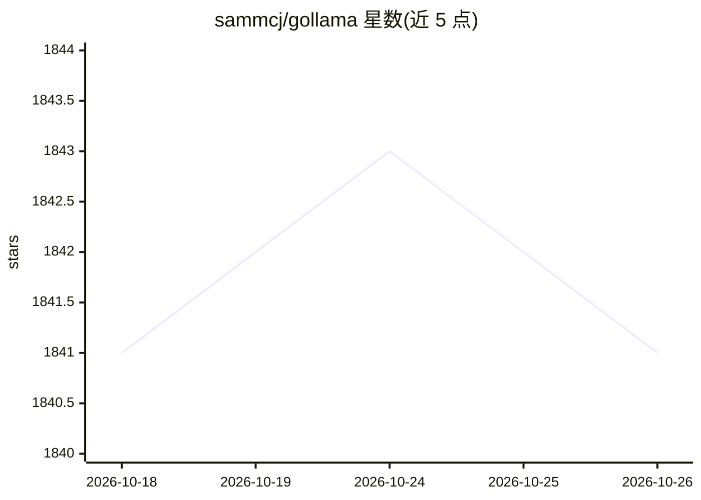

# sammcj/gollama

⭐ 1,841 · Go · MIT · 推送 2026-10-21 · [GitHub](https://github.com/sammcj/gollama) · [官网](https://smcleod.net) · 个人维护

**管理 Ollama 模型的 macOS/Linux TUI 工具**

用 Go 编写的终端界面（TUI）工具，面向本地运行 Ollama 的用户：列出、检视、删除、复制、重命名、推送模型，编辑 Modelfile，运行/卸载模型，查看运行中模型。附带 vRAM 估算功能，可对 Ollama 或 HuggingFace 模型计算显存占用、最大上下文与最优量化档。支持 JSON 配置与主题，macOS/Linux 平台。作者声明处于活跃开发中、有 bug 与缺失功能，且维护节奏放缓（v2.0.1 起移除 LM Studio 联动）。

## 筛选速览

| 维度 | 判定 | 备注 |
|---|---|---|
| AI 角色 | `ai-ecosystem` | LLM/agent 周边工具 |
| 许可风险 | `permissive` | MIT |
| 部署形态 | `desktop` | 安装包/桌面程序 |
| 模型依赖 | local-ok | 支持本地模型 |
| 硬件要求 | — | 无带数字的原话,不猜 |
| 安装摩擦 | `medium` | 含编译或系统依赖之一 |
| 成熟度 | `idea` | |

## 能力要点

- TUI 内以快捷键完成模型列表、删除、复制、运行、卸载、推送等操作
- vRAM 估算：给定内存约束找最优量化档与最大上下文，含 k/v cache 量化选项
- 支持编辑 Modelfile、按名称/大小/量化/家族等排序与正则式搜索
- JSON 配置文件与自定义终端主题

## 适用场景

- 清理和整理本地积累的 Ollama 模型
- 下载模型前估算显存占用并选择合适的量化档
- 快速编辑模型 Modelfile 并推送到私有 registry

## 场景标签

 · 领域:LLM 基础设施/模型管理

## 证据(README 行号)

> L3: Gollama is a macOS / Linux tool for managing Ollama models.
> L5: It provides a TUI (Text User Interface) for listing, inspecting, deleting, copying, and pushing Ollama models.

## 星数曲线

2026-10-18 1,841 → 2026-10-26 1,841（+0）

---
*卡片 v1 · prompt 1.4 · 生成 2026-10-21 · 置信度 high · 依据 README sha `19ce0d10546f` · [字段定义](../../DATASET.md)*
