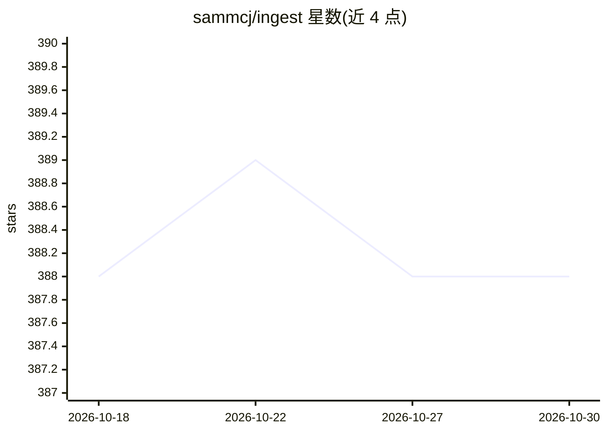

# sammcj/ingest

⭐ 388 · Go · MIT · 推送 2026-08-11 · [GitHub](https://github.com/sammcj/ingest) · 个人维护

**把代码目录/网页解析为单个 Markdown 供 AI/LLM 摄入的 CLI**

Go 编写的命令行工具：遍历目录生成文件树与合并 Markdown，支持 glob 包含/排除、git diff/log、PDF 转 Markdown、网页爬取，可复制到剪贴板或导出文件；内置离线 token 计数器（o200k/cl100k 词表编译进二进制，含 Claude 模型换算系数），或可选调用 Anthropic count_tokens API 精确计数；可通过 --llm 把生成内容发给任意 OpenAI 兼容 API 处理。还提供 Tree-sitter 代码压缩（实验性，Go/Python/JS/Bash/C/CSS）。安装途径为 go install、安装脚本或下载 release 二进制。

## 筛选速览

| 维度 | 判定 | 备注 |
|---|---|---|
| AI 角色 | `ai-ecosystem` | LLM/agent 周边工具 |
| 许可风险 | `permissive` | MIT |
| 部署形态 | `desktop` | 安装包/桌面程序 |
| 模型依赖 | — | README 未给出锁定关系 |
| 硬件要求 | — | 无带数字的原话,不猜 |
| 安装摩擦 | `low` | 无编译、无系统依赖或容器化 |
| 成熟度 | `idea` | |

## 能力要点

- 目录→单个 Markdown，支持 glob 过滤、git diff/log、PDF 与网页爬取
- 离线 token 计数（词表编译进二进制，Claude 模型带换算系数），可选 Anthropic API 精确计数
- --llm 可将生成的 prompt 发送到任意 OpenAI 兼容 API
- Tree-sitter 代码压缩（实验性，6 种语言）与自定义 Handlebars 输出模板

## 适用场景

- 把整个代码仓库整理成单个文件喂给 LLM 做代码分析
- 估算项目内容在不同模型下的 token 消耗
- 爬取并转换网页/PDF 为 Markdown 供 AI 处理

## 场景标签

`文档解析` `网页抓取` · 领域:效率与自动化

## 证据(README 行号)

> L3: Ingest parses directories of plain text files, such as source code, into a single markdown file suitable for ingesti
> L20: - Parse output directly to any OpenAI compatible API for processing
> L134: Ingest can pass the generated prompt to any OpenAI compatible API for processing.

## 星数曲线

2026-10-18 388 → 2026-10-30 388（+0）

---
*卡片 v1 · prompt 1.4 · 生成 2026-10-21 · 置信度 high · 依据 README sha `9c2d9f96f761` · [字段定义](../../DATASET.md)*
