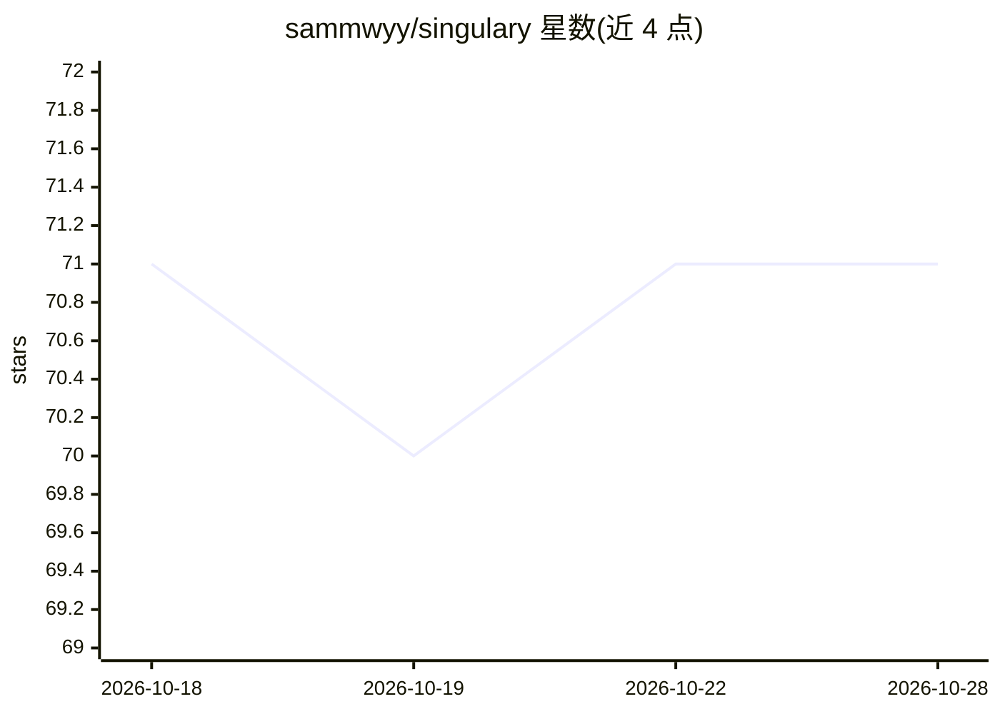

# sammwyy/singulary

⭐ 71 · TypeScript · MIT · 推送 2026-05-25 · [GitHub](https://github.com/sammwyy/singulary) · 个人维护

**自托管的 AI 应用构建平台，自带密钥与 Docker 运行时**

MIT 许可的开源自托管平台，定位为 v0/Lovable/Bolt/Replit Agent 类闭源 AI 应用构建器的替代：用户接入任意 OpenAI 兼容的 Provider（含 Ollama、LM Studio 等本地端点），由 agent 在隔离 Docker 容器内读写文件、执行 shell、重启服务并构建全栈应用。提供 Monaco 编辑器、交互终端、服务目录（PostgreSQL/Redis 等自动注入连接串）、多用户权限与令牌记账。单个 Node 进程 + SQLite，官方推荐 Docker Compose 部署；需注意其挂载 Docker socket，安全边界依赖宿主机配置。

## 筛选速览

| 维度 | 判定 | 备注 |
|---|---|---|
| AI 角色 | `ai-ecosystem` | LLM/agent 周边工具 |
| 许可风险 | `permissive` | MIT |
| 部署形态 | `self-host` | docker 或自建部署 |
| 模型依赖 | local-ok | 支持本地模型 |
| 硬件要求 | — | 无带数字的原话,不猜 |
| 安装摩擦 | `low` | 无编译、无系统依赖或容器化 |
| 成熟度 | — | 结构信号不足 |

## 能力要点

- Agent 在隔离 Docker 容器内读写文件、执行 shell、构建全栈应用
- BYOK 接入 OpenAI/Anthropic/OpenRouter/Groq/xAI/DeepSeek 或任意 OpenAI 兼容端点
- 服务目录一键供给 PostgreSQL/MySQL/MongoDB/Redis/MinIO 等，连接串自动注入环境变量
- 多用户与分组权限、令牌记账、密钥 AES-GCM 加密存储

## 适用场景

- 在本机或私有服务器自托管 AI 应用构建环境，保留密钥与代码
- 团队共享 Provider 密钥并按配额限制模型访问
- 在隔离容器里让 agent 搭建并调试带数据库的全栈项目

## 场景标签

`编码 Agent` · 领域:编码与开发

## 证据(README 行号)

> L15: Singulary is an **open-source, self-hosted alternative** to closed AI app builders like v0, Lovable, Bolt, or Repli
> L26: - 🔑 **Bring your own keys (BYOK)** — OpenAI, Anthropic, OpenRouter, Groq, Google, xAI, DeepSeek, or any OpenAI-comp

## 星数曲线

2026-10-18 71 → 2026-10-28 71（+0）

---
*卡片 v1 · prompt 1.4 · 生成 2026-10-24 · 置信度 mid · 依据 README sha `c8bd6348c7e0` · [字段定义](../../DATASET.md)*
