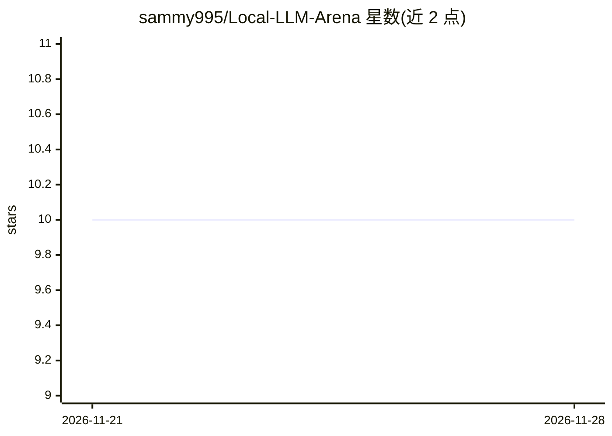

# sammy995/Local-LLM-Arena

⭐ 10 · TypeScript · MIT · 推送 2026-10-14 · [GitHub](https://github.com/sammy995/Local-LLM-Arena) · 个人维护

**本地 LLM 盲测对比平台：多模型并排评测与私有 Elo 排名**

面向本地部署场景的模型对比工具：同一提示词最多 6 个模型并排流式输出，支持盲投（名称匿名为 Model A/B/C、顺序打乱）、LLM-as-judge 自动评分、带 95% 置信区间的私有 Elo 排名，以及批处理基准（导入 .txt/.jsonl/.csv 提示集并导出 Markdown/JSON/EvalPort）。每个模型可单独设置 6 项超参数，UI 内可管理 Ollama 模型。架构为 FastAPI 后端 + React 前端，依赖 Python 3.11+、Node 20+ 与宿主机 Ollama。

## 筛选速览

| 维度 | 判定 | 备注 |
|---|---|---|
| AI 角色 | `ai-ecosystem` | LLM/agent 周边工具 |
| 许可风险 | `permissive` | MIT |
| 部署形态 | `self-host` | docker 或自建部署 |
| 模型依赖 | local-ok | 支持本地模型 |
| 硬件要求 | — | 无带数字的原话,不猜 |
| 安装摩擦 | `low` | 无编译、无系统依赖或容器化 |
| 成熟度 | — | 结构信号不足 |

## 能力要点

- 盲投票机制：匿名化、顺序随机化、揭晓后锁定
- LLM-as-judge 支持本地模型或自带 key 的云评审端点（温度固定为 0）
- 私有 Elo 排名含 95% bootstrap 置信区间与胜率矩阵
- 单模型 6 项超参数独立配置，同权重不同设置可作多条目

## 适用场景

- 在本地并排测试多个开源模型在同一提示词上的表现
- 用提示集做可复现的批处理基准评测
- 为自己微调/部署的模型积累私有 Elo 排名数据

## 场景标签

`模型评测` · 领域:评测与运维

## 证据(README 行号)

> L46: - **Side-by-side streams**: one prompt, up to six models, each in its own card. Tokens/sec, time-to-first-token, to
> L49: - **Private Elo**: pairwise ranking from votes and judge scores, with 95% bootstrap confidence intervals and a win 
> L50: - **Batch benchmark**: paste or load a `.txt` / `.jsonl` / `.csv` prompt set, judge every item, export Markdown, na

## 星数曲线

2026-11-21 10 → 2026-11-28 10（+0）

---
*卡片 v1 · prompt 1.4 · 生成 2026-11-21 · 置信度 high · 依据 README sha `cba542a26b18` · [字段定义](../../DATASET.md)*
