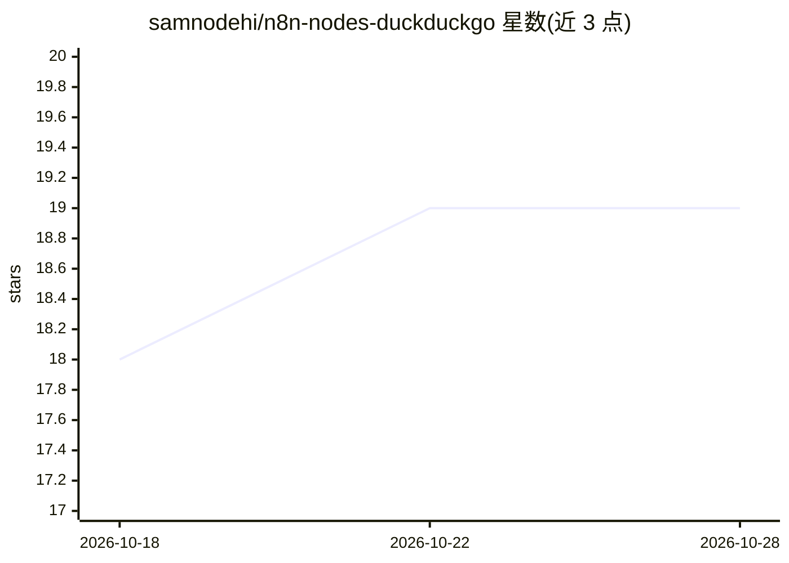

# samnodehi/n8n-nodes-duckduckgo

⭐ 19 · TypeScript · MIT · 推送 2026-10-27 · [GitHub](https://github.com/samnodehi/n8n-nodes-duckduckgo) · [官网](https://www.npmjs.com/package/n8n-nodes-duckduckgo-search) · 个人维护

**n8n 社区节点：在 n8n 工作流中集成 DuckDuckGo 搜索**

TypeScript 编写的 n8n 社区节点，通过 DuckDuckGo 公共搜索端点提供 Web/图片/新闻/视频四类搜索，另有任意 URL 正文提取、Instant Answer 与搜索建议操作，全部无需 API key。节点设置 usableAsTool: true，可作为 n8n AI Agent 工作流中的工具被调用。识别 DuckDuckGo 的 202 人机验证限流页并本地退避约一分钟；对数据中心/共享 IP（n8n Cloud、VPS、CI）会较快触发限流。结果 URL 去除广告点击追踪参数，News/Video 支持备选结果路径并标注 isFallback。

## 筛选速览

| 维度 | 判定 | 备注 |
|---|---|---|
| AI 角色 | `ai-ecosystem` | LLM/agent 周边工具 |
| 许可风险 | `permissive` | MIT |
| 部署形态 | `library` | 以包/库形式分发 |
| 模型依赖 | — | README 未给出锁定关系 |
| 硬件要求 | — | 无带数字的原话,不猜 |
| 安装摩擦 | `low` | 无编译、无系统依赖或容器化 |
| 成熟度 | — | 结构信号不足 |

## 能力要点

- Web/Image/News/Video 四类搜索 + Instant Answer 与搜索建议，无需 API key
- usableAsTool: true，可直接挂到 n8n AI Agent 节点作为工具
- 识别限流验证页并本地退避，空数组即无结果而非被封锁
- 任意 URL 正文提取（最多读前 2MB HTML），可作为 Agent 的读页工具

## 适用场景

- 在 n8n 自动化工作流中执行免费无 key 的网络搜索
- 给 n8n AI Agent 挂载搜索与网页阅读工具
- 按域名/URL 对搜索结果做本地排序与过滤

## 场景标签

`工作流自动化` `网页抓取` · 领域:效率与自动化

## 证据(README 行号)

> L9: An n8n community node for DuckDuckGo search. Search the web, find images, discover news, and explore videos — no API
> L28: - **AI Agent compatible**: Works as a tool in n8n AI Agent workflows (`usableAsTool: true`)
> L46: - **Works as an n8n AI Agent tool** — attach it to any Agent node; no extra setup needed

## 星数曲线

2026-10-18 18 → 2026-10-28 19（+1）

---
*卡片 v1 · prompt 1.4 · 生成 2026-10-28 · 置信度 high · 依据 README sha `d5329c6d2472` · [字段定义](../../DATASET.md)*
