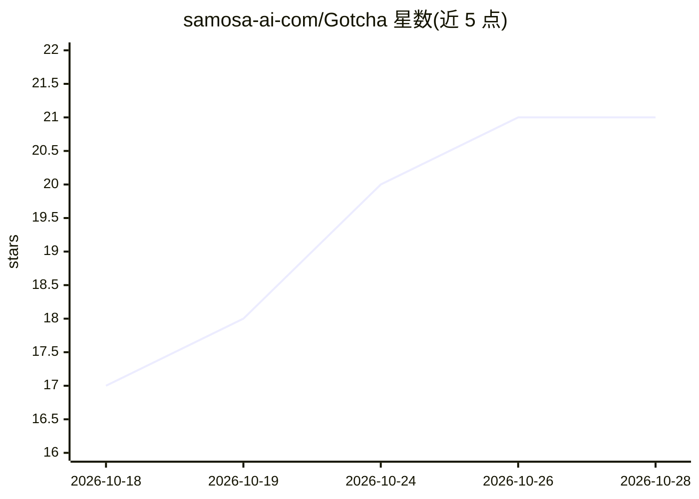

# samosa-ai-com/Gotcha

⭐ 21 · Kotlin · NOASSERTION · 推送 2026-10-25 · [GitHub](https://github.com/samosa-ai-com/Gotcha) · [官网](https://samosa-ai.com/gotcha) · 组织维护

**安卓端上 AI 副驾：自然语言驱动的全设备操作应用**

单 APK 安装于 Android 11+ 的自包含应用：LLM 读取用户请求与实时设备上下文，从 100+ 设备控制工具（通话、短信、日历、文件、终端、屏幕自动化、root 等）中选取并执行真实操作。支持自带任意 OpenAI 兼容 API key（OpenAI/OpenRouter/Groq 或本地 llama.cpp/LM Studio/Ollama），密钥仅加密存于设备，也可登录 Samosa AI 免 key。提供 Monitor 只读与 Operator 全权两种模式，含敏感操作确认门与审计日志；文本提取在设备端完成，LLM 推理可云端或本地。限制：模型幻觉可能导致意外操作，官方建议从 Monitor 模式起步。

## 筛选速览

| 维度 | 判定 | 备注 |
|---|---|---|
| AI 角色 | `ai-native` | 本体是模型或模型工具 |
| 许可风险 | `none` | NOASSERTION |
| 部署形态 | `None` |  |
| 模型依赖 | local-ok | 支持本地模型 |
| 硬件要求 | — | 无带数字的原话,不猜 |
| 安装摩擦 | `low` | 无编译、无系统依赖或容器化 |
| 成熟度 | — | 结构信号不足 |

## 能力要点

- 100+ 设备控制工具，自然语言驱动真实设备操作
- 自带 API key（OpenAI/OpenRouter/Groq/本地 llama.cpp·LM Studio·Ollama），密钥设备端加密不同步
- Monitor/Operator 双模式、敏感操作确认门与 append-only 审计日志
- 支持 MCP Server 接入自定义工具、Termux Linux shell 工具

## 适用场景

- 用一句话让手机代发短信、清理空间或查询屏幕内容
- 通过悬浮球在任何应用上发起语音对话操作设备
- 圈选屏幕内容复制、翻译或提问（文本提取端上完成）

## 场景标签

`AI 助手` `GUI 自动化` · 领域:效率与自动化

## 证据(README 行号)

> L17: Say *"text mom I'm running late"*, *"free up some space"*, or *"what's on my screen?"*. An LLM reads your request p
> L19: Everything runs in **one self-contained app on your phone**. Bring your own API key (OpenAI, OpenRouter, Groq, or a

## 星数曲线

2026-10-18 17 → 2026-10-28 21（+4）

---
*卡片 v1 · prompt 1.4 · 生成 2026-10-28 · 置信度 high · 依据 README sha `f206a5562577` · [字段定义](../../DATASET.md)*
