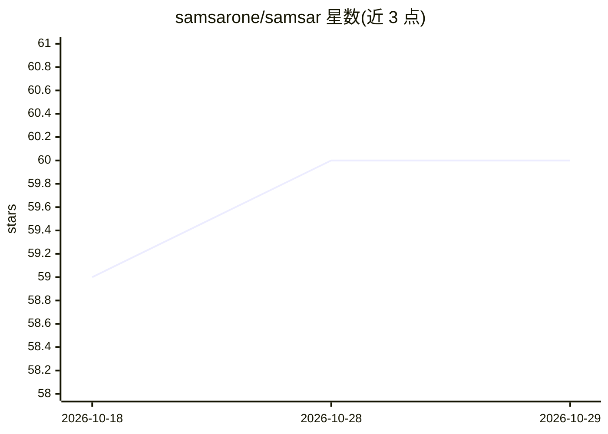

# samsarone/samsar

⭐ 60 · JavaScript · MIT · 推送 2026-10-24 · [GitHub](https://github.com/samsarone/samsar) · [官网](https://www.samsar.one) · 组织维护

**生成式视频与媒体自动化平台：提示词/产品图生成成品视频**

生成式视频云平台，通过 Studio 界面与 API 提供文生视频（最长 3 分钟）、图片列表转广告视频、图像编辑、音频生成、语义搜索与推荐，并支持多提供商模型路由（OpenAI、Google Cloud、OpenRouter、FAL、ElevenLabs、RunwayML 等）。使用方式有两种：托管 Studio/samsar-js 客户端（按额度计费，无需本地 Docker），或通过 setup.sh/setup.ps1 启动器安装独立部署（Docker Compose，本地提供 Studio、Processor API、MinIO、Grafana 等服务），并附五步配置向导。MIT 许可。

## 筛选速览

| 维度 | 判定 | 备注 |
|---|---|---|
| AI 角色 | `ai-native` | 本体是模型或模型工具 |
| 许可风险 | `permissive` | MIT |
| 部署形态 | `self-host` | docker 或自建部署 |
| 模型依赖 | — | README 未给出锁定关系 |
| 硬件要求 | — | 无带数字的原话,不猜 |
| 安装摩擦 | `low` | 无编译、无系统依赖或容器化 |
| 成熟度 | — | 结构信号不足 |

## 能力要点

- One-shot 文生视频最长 3 分钟，支持纪录片/教育/影视摘要等类型
- 图片列表转广告视频，可含解说虚拟形象、片尾与 CTA
- 多提供商模型路由，覆盖视频/图像/音频/推理
- 支持托管模式与 Docker Compose 独立部署（五步配置向导）

## 适用场景

- 用提示词或产品图快速生成营销/教育类成品视频
- 自托管一套生成式视频生产平台并接入自有模型提供商
- 构建带语义搜索与推荐的视频素材库

## 场景标签

`视频生成` `语义搜索` `推荐系统` · 领域:内容生成

## 证据(README 行号)

> L5:  Samsar is a generative video and media automation platform for turning prompts, product images, structured content,
> L40: - **One-shot Studio text-to-video up to 3 minutes** for documentary, infotainment, ed-tech, film summary, custom th
> L45: - **Multi-provider model routing** so each operation can use the best available provider and model.

## 星数曲线

2026-10-18 59 → 2026-10-29 60（+1）

---
*卡片 v1 · prompt 1.4 · 生成 2026-10-24 · 置信度 high · 依据 README sha `75f3248c45a5` · [字段定义](../../DATASET.md)*
