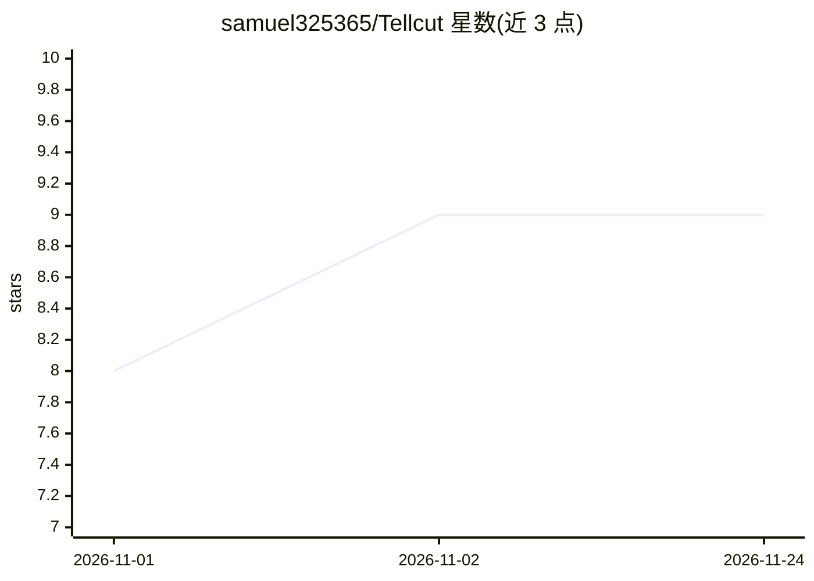

# samuel325365/Tellcut

⭐ 9 · TypeScript · MIT · 推送 2026-11-24 · [GitHub](https://github.com/samuel325365/Tellcut) · [官网](https://samuel325365.github.io/Tellcut/) · 个人维护 · 中文 README

**对话式本地视频剪辑器：AI agent 看素材、写分镜并剪初稿**

运行于本机浏览器的视频编辑器，将 Claude Code 作为剪辑 agent：导入素材后自动分场景、生成联络表、转写语音、识别内嵌字幕与水印，先判断影片类型并写分镜，再剪出可预览的初稿。用户可在时间线上手动修改、或在聊天中要求改动，改动需按 Accept 才生效；支持收藏效果块与保存预设供后续项目复用。提供 160+ 效果、约 140 种字幕样式、多种比例导出 MP4，导出前自检黑帧、字幕漂移等问题并自动修复。

## 筛选速览

| 维度 | 判定 | 备注 |
|---|---|---|
| AI 角色 | `ai-native` | 本体是模型或模型工具 |
| 许可风险 | `permissive` | MIT |
| 部署形态 | `None` |  |
| 模型依赖 | locked-api |  |
| 硬件要求 | — | 无带数字的原话,不猜 |
| 安装摩擦 | `medium` | 含编译或系统依赖之一 |
| 成熟度 | — | 结构信号不足 |

## 能力要点

- agent 观看每个片段：分场景、转写语音、识别内嵌字幕与水印
- 改动先预览、按 Accept 才生效，不覆盖手动修改
- 效果块与预设可复用，下一部影片延续同一风格
- 导出 MP4 支持 9:16/16:9/1:1/4:5，竖版重构图保持人脸在画面内

## 适用场景

- 把旅行素材用一句话剪成竖版短视频
- 从长视频或播客中截取精彩片段并配逐字字幕
- 用 logo 与一段介绍生成品牌影片
- 把照片和片段剪成婚礼、生日等纪念影片

## 场景标签

`视频生成` `语音识别` · 领域:内容生成

## 证据(README 行号)

> L3:  Video editing, by talking.
> L5:  Drop in your footage and say what you want. An agent watches every clip, writes the storyboard and cuts a first dra
> L145: - **A Claude account**: a Pro, Max, Team or Enterprise plan, or a Claude API account. The editing agent is Claude 

## 星数曲线

2026-11-01 8 → 2026-11-24 9（+1）

---
*卡片 v1 · prompt 1.4 · 生成 2026-11-20 · 置信度 high · 依据 README sha `cccedb3553b7` · [字段定义](../../DATASET.md)*
