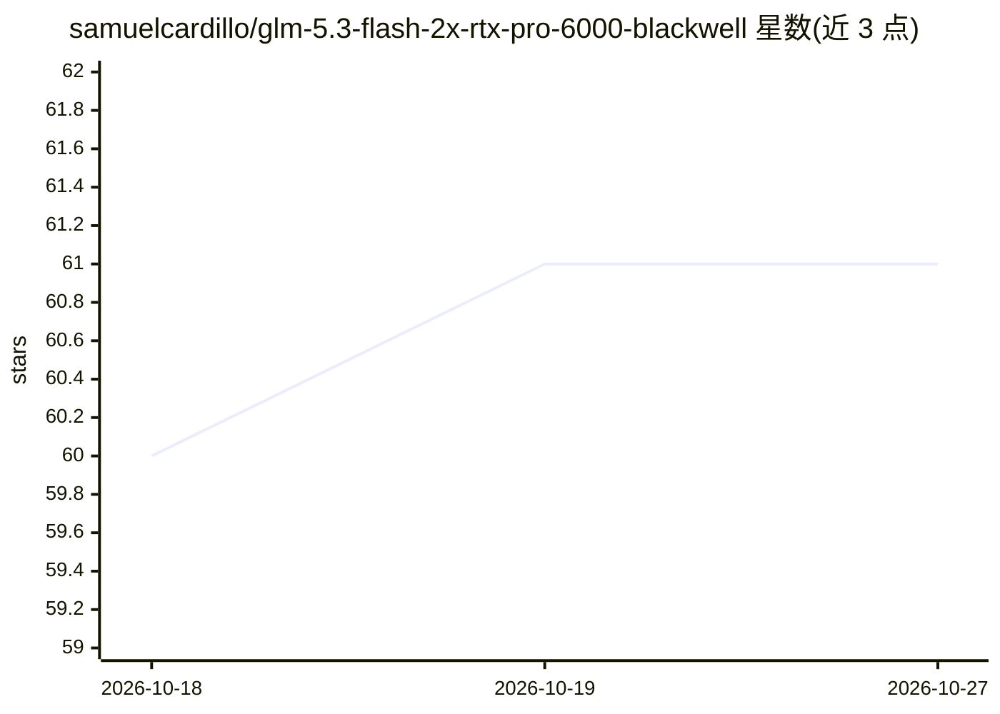

# samuelcardillo/glm-5.3-flash-2x-rtx-pro-6000-blackwell

⭐ 61 · Python · Apache-2.0 · 推送 2026-09-20 · [GitHub](https://github.com/samuelcardillo/glm-5.3-flash-2x-rtx-pro-6000-blackwell) · 个人维护

**GLM-5.3 Flash 双卡本地部署配方：2×RTX PRO 6000 百万上下文推理**

面向本地部署者的 GLM-5.3 Flash 运行配方仓库：在两块 96GB RTX PRO 6000 Blackwell GPU 上以 vLLM 运行时（tpurtell v0.6 镜像按 OCI 摘要固定）提供 OpenAI 兼容 API，含 EXL3/K3 量化目标模型与 DFlash2 投机解码草稿模型，支持最高 1,048,576 token 请求、单请求 16 图像输入与工具调用。提供下载、构建 overlay、预检、启动、验证、基准与服务化脚本；带失败工具调用循环防护代理。限制：DFlash2 草稿模型为 CC BY-NC-ND 4.0 研究许可，商用需另行授权；不重新分发权重。

## 筛选速览

| 维度 | 判定 | 备注 |
|---|---|---|
| AI 角色 | `ai-ecosystem` | LLM/agent 周边工具 |
| 许可风险 | `permissive` | Apache-2.0 |
| 部署形态 | `None` |  |
| 模型依赖 | local-ok | 支持本地模型 |
| 硬件要求 | — | 无带数字的原话,不猜 |
| 安装摩擦 | `medium` | 含编译或系统依赖之一 |
| 成熟度 | — | 结构信号不足 |

## 能力要点

- 1,048,576 token 请求上限与六针检索验证（6/6）
- DFlash2 投机解码，C16 并发实测聚合解码 1,045.47 tok/s
- 工具调用循环防护代理：两次相同失败调用后强制改换动作
- 全链路修订固定：模型哈希、OCI 镜像摘要、RECIPE_PIN 与预检校验

## 适用场景

- 在双 RTX PRO 6000 Blackwell 上本地跑百万上下文 GLM-5.3 Flash
- 部署带视觉输入与工具调用的局域网 OpenAI 兼容推理端点
- 复现并验证长上下文与投机解码性能基准

## 场景标签

`多模态` `推理引擎` · 领域:感知与多模态

## 证据(README 行号)

> L3: A revision-pinned, OpenAI-compatible recipe for one-million-token context, 16-image prompts, and high-throughput DFl
> L134: The public API is served by `scripts/tool-loop-guard.py`; vLLM itself is published only on loopback `UPSTREAM_PORT

## 星数曲线

2026-10-18 60 → 2026-10-27 61（+1）

---
*卡片 v1 · prompt 1.4 · 生成 2026-10-24 · 置信度 high · 依据 README sha `e0c4578b5a07` · [字段定义](../../DATASET.md)*
