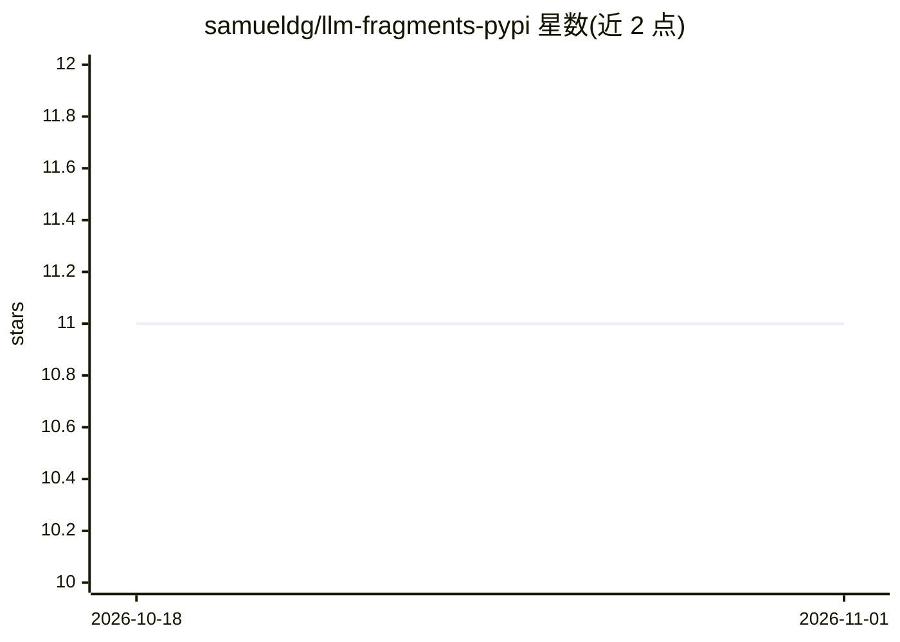

# samueldg/llm-fragments-pypi

⭐ 11 · Python · Apache-2.0 · 推送 2026-10-19 · [GitHub](https://github.com/samueldg/llm-fragments-pypi) · 个人维护

**LLM 插件：将 PyPI 包元数据加载为提示片段**

为 LLM 工具提供的 fragments 插件：通过 `-f pypi:package_name` 语法将 PyPI 包的 README 与元数据注入提示上下文，支持 `@version` 指定版本、多片段组合，并可与 llm 的 schema 等特性联用。安装方式为在 LLM 同环境中执行 `llm install llm-fragments-pypi`；开发流程基于 uv，含 ruff 格式化与 pytest 测试。面向使用 llm 命令行工具的开发者。

## 筛选速览

| 维度 | 判定 | 备注 |
|---|---|---|
| AI 角色 | `ai-ecosystem` | LLM/agent 周边工具 |
| 许可风险 | `permissive` | Apache-2.0 |
| 部署形态 | `library` | 以包/库形式分发 |
| 模型依赖 | — | README 未给出锁定关系 |
| 硬件要求 | — | 无带数字的原话,不猜 |
| 安装摩擦 | `low` | 无编译、无系统依赖或容器化 |
| 成熟度 | — | 结构信号不足 |

## 能力要点

- 以 `-f pypi:包名` 加载包 README 与元数据
- 支持 `@version` 后缀指定包版本
- 多片段组合并可与其他 llm 特性联用

## 适用场景

- 让 LLM 基于某 PyPI 包的文档回答问题
- 对比多个包（如 litestar 与 fastapi）的异同
- 查询特定版本的包所支持的 Python 版本

## 场景标签

`提示工程` `RAG` · 领域:Agent 开发

## 证据(README 行号)

> L1: # llm-fragments-pypi
> L15: Use `-f pypi:package_name` to include the package's README and metadata as fragments.

## 星数曲线

2026-10-18 11 → 2026-11-01 11（+0）

---
*卡片 v1 · prompt 1.4 · 生成 2026-11-01 · 置信度 high · 依据 README sha `fbcafaa63ccb` · [字段定义](../../DATASET.md)*
