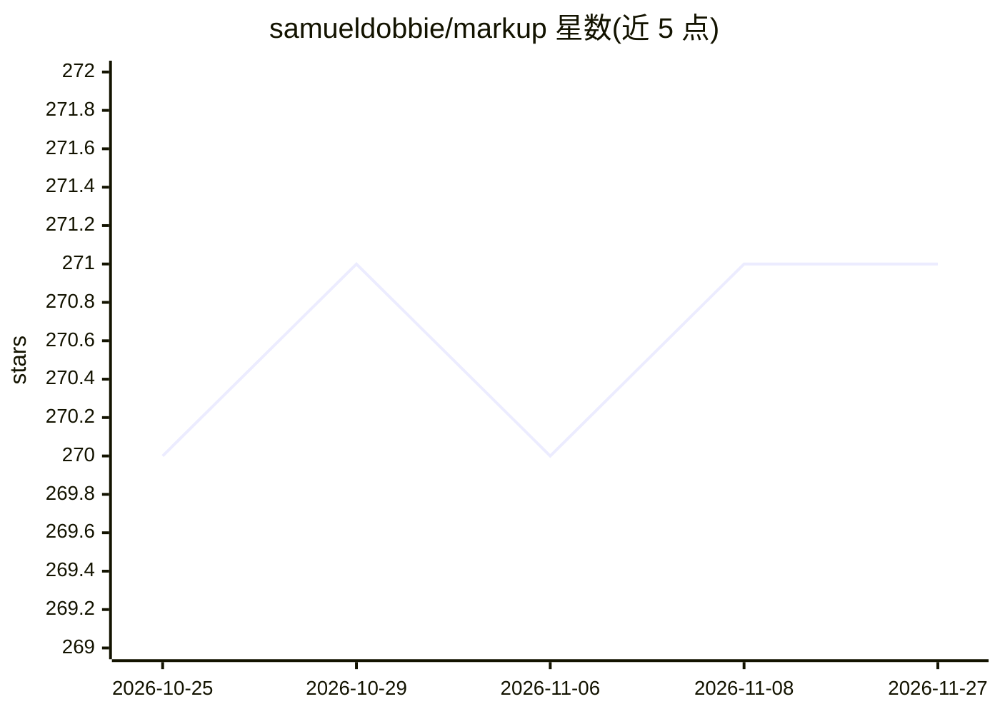

# samueldobbie/markup

⭐ 271 · TypeScript · MIT · 推送 2026-11-19 · [GitHub](https://github.com/samueldobbie/markup) · [官网](https://getmarkup.com) · 个人维护

**面向 NLP/ML 从业者的 AI 辅助网页文档标注工具**

Markup 是一个网页端文档标注工具，将非结构化文档转换为 NLP/ML 任务所需的结构化格式，如命名实体识别。它在用户标注过程中用机器学习预测并建议复杂标注，并提供 UMLS、SNOMED-CT、ICD-10 等常用本体及自定义本体的接入与预测性概念映射。AI 建议通过工作区指向用户自己的 OpenAI Chat Completions 兼容 HTTP API（含本地端点），本产品不托管模型。本地运行需克隆仓库用 pnpm 安装并启动 Supabase，支持以 Docker 服务部署到 Render。

## 筛选速览

| 维度 | 判定 | 备注 |
|---|---|---|
| AI 角色 | `ai-native` | 本体是模型或模型工具 |
| 许可风险 | `permissive` | MIT |
| 部署形态 | `self-host` | docker 或自建部署 |
| 模型依赖 | local-ok | 支持本地模型 |
| 硬件要求 | — | 无带数字的原话,不猜 |
| 安装摩擦 | `low` | 无编译、无系统依赖或容器化 |
| 成熟度 | — | 结构信号不足 |

## 能力要点

- 预测性标注：标注过程中实时建议实体与属性
- 集成 UMLS/SNOMED-CT/ICD-10 等本体并支持自定义上传
- AI 端点完全由用户自配，兼容 OpenAI Chat Completions 协议（含 Ollama 本地端点）
- Docker 部署：API 与前端构建产物同进程服务

## 适用场景

- 为 NER 等任务标注文本数据集
- 把医学文档映射到 UMLS/SNOMED-CT 等标准术语
- 接入本地模型对文档级标注给出建议供人工确认

## 场景标签

 · 领域:数据标注/机器学习工具

## 证据(README 行号)

> L3: Markup is an online annotation tool that can be used to transform unstructured documents into structured formats for
> L31: Markup does not call a Markup-hosted model. Each workspace points at **your** HTTP API. That API must speak the Ope

## 星数曲线

2026-10-25 270 → 2026-11-27 271（+1）

---
*卡片 v1 · prompt 1.4 · 生成 2026-11-25 · 置信度 mid · 依据 README sha `26bf631fee26` · [字段定义](../../DATASET.md)*
