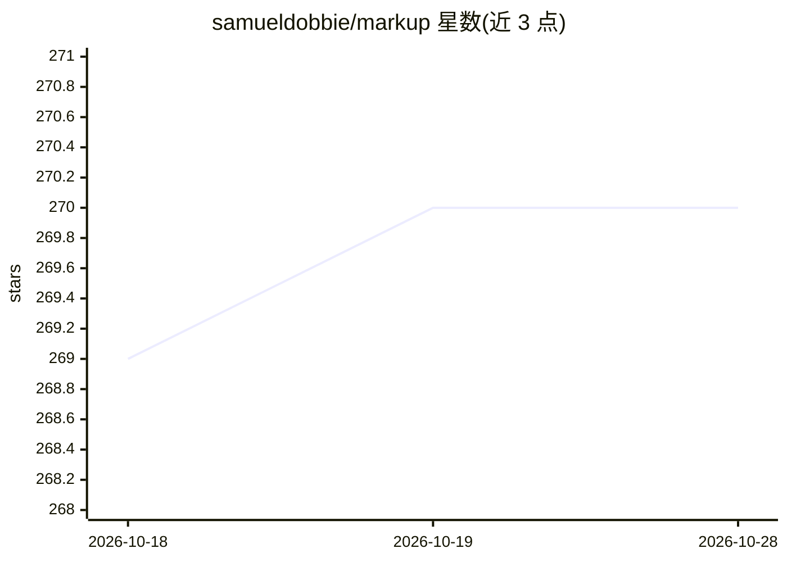

# samueldobbie/markup

⭐ 270 · TypeScript · MIT · 推送 2026-10-25 · [GitHub](https://github.com/samueldobbie/markup) · [官网](https://getmarkup.com) · 个人维护

**给 NLP/ML 从业者的 AI 辅助文档标注与本体映射工具**

Web 端文档标注工具，将非结构化文档转为 NLP/ML 任务（如命名实体识别）所需的格式。标注过程中由机器学习预测建议实体与属性，并可预测到标准术语体系的映射；内置 UMLS、SNOMED-CT、ICD-10 等常见本体访问，支持上传自定义本体。AI 建议通过工作区指向用户自己的 OpenAI Chat Completions 协议端点（Claude、OpenAI 或本地 Ollama 等），不调用 Markup 托管模型。本地运行需 git clone 源码并配合 Supabase，部署到 Render 为 Docker 服务。

## 筛选速览

| 维度 | 判定 | 备注 |
|---|---|---|
| AI 角色 | `ai-ecosystem` | LLM/agent 周边工具 |
| 许可风险 | `permissive` | MIT |
| 部署形态 | `self-host` | docker 或自建部署 |
| 模型依赖 | local-ok | 支持本地模型 |
| 硬件要求 | — | 无带数字的原话,不猜 |
| 安装摩擦 | `low` | 无编译、无系统依赖或容器化 |
| 成熟度 | — | 结构信号不足 |

## 能力要点

- 机器学习预测式标注：标注时建议实体、属性与文档级标注
- 集成常见本体（UMLS/SNOMED-CT/ICD-10）与自定义本体上传
- 工作区接入任意 OpenAI Chat Completions 协议端点，含本地服务器
- 预测式本体映射：基于文本建议标准术语映射

## 适用场景

- 为命名实体识别等 NLP 任务标注文档并导出结构化格式
- 在标注中借助 AI 建议提高标注效率
- 将文本概念映射到医学标准术语体系

## 场景标签

 · 领域:NLP/数据标注工具

## 证据(README 行号)

> L3: Markup is an online annotation tool that can be used to transform unstructured documents into structured formats for
> L26: To use AI suggestions, open a workspace, click **Configure AI**, and pick Claude or OpenAI (or **Custom** for a loc
> L30: Markup does not call a Markup-hosted model. Each workspace points at **your** HTTP API. That API must speak the Ope

## 星数曲线

2026-10-18 269 → 2026-10-28 270（+1）

---
*卡片 v1 · prompt 1.4 · 生成 2026-10-22 · 置信度 high · 依据 README sha `8a600aa0373b` · [字段定义](../../DATASET.md)*
