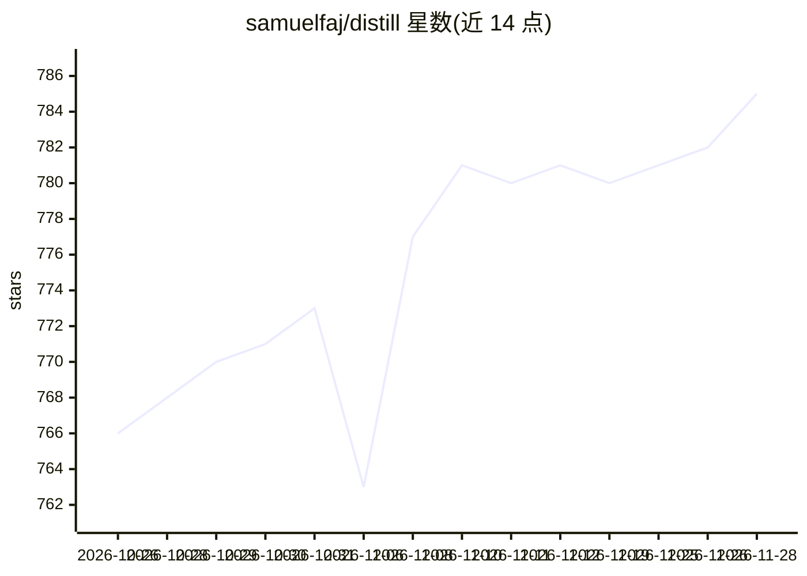

# samuelfaj/distill

⭐ 785 · Rust · Apache-2.0 · 推送 2026-11-25 · [GitHub](https://github.com/samuelfaj/distill) · [官网](https://www.samuelfaj.com/en/distill/) · 个人维护

**省 token 的编码 agent harness 与 TUI，面向订阅用户**

Distill 是一个轻量级编码 agent harness 与终端 UI，目标是让每次编码任务消耗更少的 token。它支持 Grok、Claude、Codex 订阅账号登录，也支持任何 OpenAI 兼容协议的模型，并可经 OpenRouter 登录接入。核心机制是三层模型分工（主模型规划与审查、worker 模型执行委派、utility 模型做摘要压缩），配合 UltraSave/UltraFast/UltraCode/Auto/Normal 五种执行模式与内置的 Caveman、Ponytail 两套常驻系统提示规则。提供 Mac/Linux/Windows 安装脚本，README 含成本/耗时基准表并链接 BENCHMARKS.md 方法论。

## 筛选速览

| 维度 | 判定 | 备注 |
|---|---|---|
| AI 角色 | `ai-ecosystem` | LLM/agent 周边工具 |
| 许可风险 | `permissive` | Apache-2.0 |
| 部署形态 | `None` |  |
| 模型依赖 | — | README 未给出锁定关系 |
| 硬件要求 | — | 无带数字的原话,不猜 |
| 安装摩擦 | `low` | 无编译、无系统依赖或容器化 |
| 成熟度 | — | 结构信号不足 |

## 能力要点

- 三层模型分工：main/worker/utility 模型可分别配置与选档
- 五种执行模式（UltraSave/UltraFast/UltraCode/Auto/Normal）
- 内置 Caveman 与 Ponytail 常驻提示规则集，压缩输出与最小化写码
- 支持订阅账号与 OpenAI 兼容协议模型接入

## 适用场景

- 用现有订阅跑编码 agent 时降低 token 成本
- 让强模型做规划、廉价模型执行委派任务
- 在终端中对比不同执行模式的成本与耗时

## 场景标签

`编码 Agent` `模型网关` · 领域:Agent 开发

## 证据(README 行号)

> L5: Distill is a lightweight coding agent harness and TUI, built to **get far more done
> L8: It works with Grok, Claude and Codex subscriptions, and with any model that speaks the
> L87: |Main model|Required. Owns every session: it plans, specifies, delegates, and reviews the work.|`/model` or `/tiers

## 星数曲线

2026-10-26 766 → 2026-11-28 785（+19）

---
*卡片 v1 · prompt 1.4 · 生成 2026-11-24 · 置信度 high · 依据 README sha `0d2cd4df0178` · [字段定义](../../DATASET.md)*
