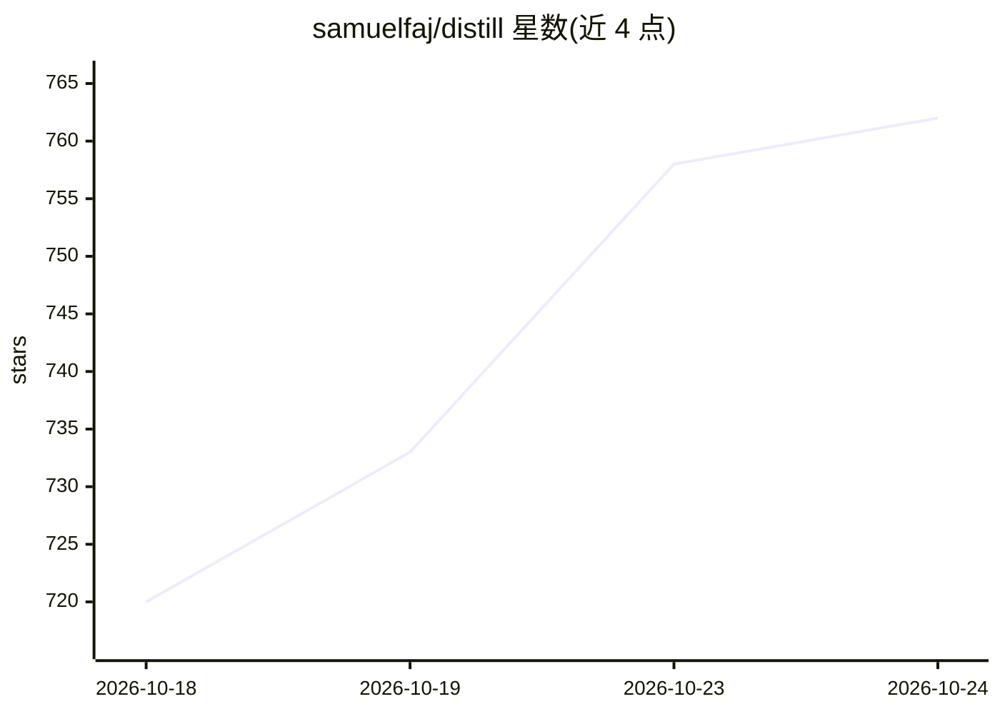

# samuelfaj/distill

⭐ 762 · Rust · Apache-2.0 · 推送 2026-10-23 · [GitHub](https://github.com/samuelfaj/distill) · 个人维护

**省 token 的编码 agent 运行框架与 TUI，支持多模型订阅**

轻量级编码 agent harness 与终端 UI（TUI），通过多种执行模式压缩 token 消耗与运行时间：UltraSave 缩减搜索/读取/报告规模，UltraFast 跳过规划轮次，UltraCode 以并行子代理拆分任务并校验结果。模型接入兼容 OpenAI 协议、Grok/Codex 订阅及 OpenRouter 登录，支持主/Worker/Utility 三层模型配置，内置 Caveman 压缩与 Ponytail 复用规则（均不可关闭）。提供 Mac/Linux/Windows 安装脚本与 distill update 升级命令，另有 headless 模式。成本与速度数据来自项目自带 20 例基准，细节见 BENCHMARKS.md。

## 筛选速览

| 维度 | 判定 | 备注 |
|---|---|---|
| AI 角色 | `ai-ecosystem` | LLM/agent 周边工具 |
| 许可风险 | `permissive` | Apache-2.0 |
| 部署形态 | `None` |  |
| 模型依赖 | locked-api |  |
| 硬件要求 | — | 无带数字的原话,不猜 |
| 安装摩擦 | `low` | 无编译、无系统依赖或容器化 |
| 成熟度 | — | 结构信号不足 |

## 能力要点

- UltraSave/UltraFast/UltraCode 三种执行模式，可用斜杠命令或 flag 切换
- 主/Worker/Utility 三层模型配置，每层可设 effort 或 auto
- 内置不可关闭的 Caveman 压缩与 Ponytail 代码复用规则集
- 兼容 OpenAI 协议模型与 Grok/Codex 订阅

## 适用场景

- 在编码 agent 工作流中降低 token 消耗
- 用已有模型订阅跑本地 TUI 编码代理
- 通过并行子代理拆分并加速编码任务

## 场景标签

`编码 Agent` `Agent 框架` · 领域:Agent 开发

## 证据(README 行号)

> L5: Distill is a lightweight coding agent harness and TUI, built to **get far more done
> L8: It works with Grok and Codex subscriptions, and with any model that speaks the

## 星数曲线

2026-10-18 720 → 2026-10-24 762（+42）

---
*卡片 v1 · prompt 1.4 · 生成 2026-10-22 · 置信度 high · 依据 README sha `c16f143f28da` · [字段定义](../../DATASET.md)*
