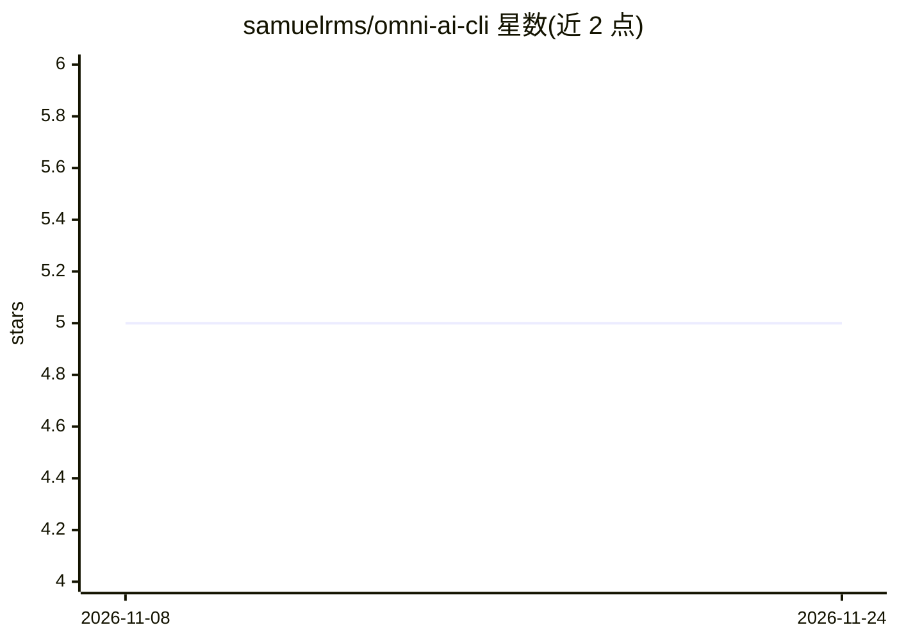

# samuelrms/omni-ai-cli

⭐ 5 · Python · MIT · 推送 2026-11-23 · [GitHub](https://github.com/samuelrms/omni-ai-cli) · [官网](https://omni.samuelramos.dev) · 个人维护

**把 Claude Code/Codex/OpenRouter 等多工具接入统一终端聊天并按成本路由的 CLI**

一个终端聊天工具，将 Claude Code、Codex、Cursor、Antigravity、Grok、DeepSeek 与 OpenRouter 汇聚在同一命令行入口：用户输入后由路由器决定由哪个工具应答，失败或达到配额时自动切换到下一个；简单问题走低价工具，重任务走 Claude 并支持多账号轮换。响应生成时输入不阻塞，请求进入可见队列按序执行；`ai serve` 可将其暴露为兼容 OpenAI 的 API，支持 Docker 运行。历史记录持久化，界面支持葡/英/西/法四语，模型与账号可在聊天内配置。

## 筛选速览

| 维度 | 判定 | 备注 |
|---|---|---|
| AI 角色 | `ai-ecosystem` | LLM/agent 周边工具 |
| 许可风险 | `permissive` | MIT |
| 部署形态 | `desktop` | 安装包/桌面程序 |
| 模型依赖 | locked-api |  |
| 硬件要求 | — | 无带数字的原话,不猜 |
| 安装摩擦 | `low` | 无编译、无系统依赖或容器化 |
| 成熟度 | — | 结构信号不足 |

## 能力要点

- 按成本路由与失败/限额自动 fallback，多 Claude 账号独立登录目录轮换
- `ai serve` 提供兼容 OpenAI 的 API，可直接或 Docker 运行
- 请求队列不阻塞输入，支持 /usage 成本统计与 /parallel 并行分析
- 附带 VS Code / Cursor 扩展，复用同一 CLI

## 适用场景

- 在终端统一使用多个 AI 编码工具而不逐个切换
- 用低成本模型处理简单问题、重任务自动路由到 Claude
- Claude 账号达到用量上限时自动换号继续工作
- 通过兼容 OpenAI 的 API 在其他工具中调用这些模型

## 场景标签

`模型网关` `聊天机器人` · 领域:Agent 开发

## 证据(README 行号)

> L19: Um terminal de chat que junta **Claude Code, Codex, Cursor, Antigravity, Grok, DeepSeek e
> L26: Com `ai serve`, tudo isso também fica disponível como uma API compatível com a OpenAI, direto ou em Docker.
> L40: direto: ele dispara o roteador (`omni_ai/cli/`) como subprocesso e lê os eventos que ele

## 星数曲线

2026-11-08 5 → 2026-11-24 5（+0）

---
*卡片 v1 · prompt 1.4 · 生成 2026-11-21 · 置信度 mid · 依据 README sha `cb512634f4af` · [字段定义](../../DATASET.md)*
