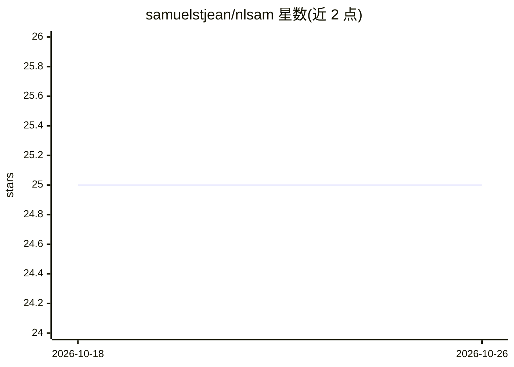

# samuelstjean/nlsam

⭐ 25 · Python · GPL-3.0 · 推送 2026-09-20 · [GitHub](https://github.com/samuelstjean/nlsam) · 个人维护

**扩散 MRI 去噪算法 NLSAM 的参考实现**

Non Local Spatial and Angular Matching (NLSAM) 去噪算法的参考实现，面向扩散 MRI 数据。处理流程为：先将 Rician 或非中心卡方分布的数据变换为高斯分布信号，再执行 NLSAM 去噪；包含基于 Koay 等人 2009 年工作的偏差校正框架，以及自动估计噪声分布的功能（autodmri, 2020）。提供 pip 安装的 Python 包与 nlsam_denoising 命令行工具，输入 NIfTI 格式数据、bvals/bvecs 与掩膜进行去噪，附示例数据集（论文数据可下载）。算法详见 St-Jean 等人 2016 年 Medical Image Analysis 论文。

## 筛选速览

| 维度 | 判定 | 备注 |
|---|---|---|
| AI 角色 | `ai-native` | 本体是模型或模型工具 |
| 许可风险 | `viral` | GPL-3.0 |
| 部署形态 | `library` | 以包/库形式分发 |
| 模型依赖 | — | README 未给出锁定关系 |
| 硬件要求 | — | 无带数字的原话,不猜 |
| 安装摩擦 | `low` | 无编译、无系统依赖或容器化 |
| 成熟度 | — | 结构信号不足 |

## 能力要点

- 扩散 MRI 的 NLSAM 去噪参考实现
- 支持 Rician/非中心卡方到高斯分布的信号变换
- 偏差校正框架与自动噪声分布估计
- 提供 nlsam_denoising 命令行工具与示例数据集

## 适用场景

- 对扩散 MRI 数据做自适应去噪
- 提升扩散 MRI 数据集的空间分辨率处理质量
- 研究场景中复现 NLSAM 算法结果

## 场景标签

`图像视频处理` · 领域:感知与多模态

## 证据(README 行号)

> L3: The reference implementation for the Non Local Spatial and Angular Matching (NLSAM) denoising algorithm for diffusio
> L24: The process is to first transform your data to Gaussian distributed signals if your dataset is
> L30: nlsam_denoising dwi.nii.gz dwi_nlsam.nii.gz bvals bvecs -m mask.nii.gz

## 星数曲线

2026-10-18 25 → 2026-10-26 25（+0）

---
*卡片 v1 · prompt 1.4 · 生成 2026-10-26 · 置信度 high · 依据 README sha `53e4322b5869` · [字段定义](../../DATASET.md)*
