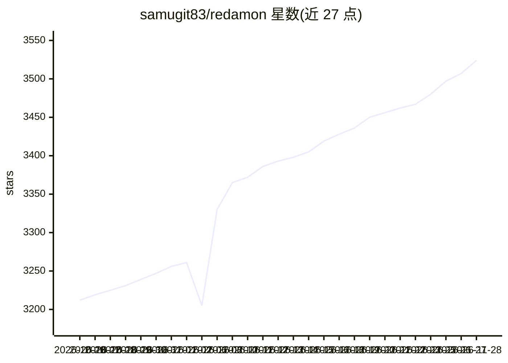

# samugit83/redamon

⭐ 3,524 · Python · MIT · 推送 2026-11-25 · [GitHub](https://github.com/samugit83/redamon) · [官网](https://www.redamon.org) · 组织维护

**自托管 AI 渗透测试平台：图化攻击面并代理利用、出修复 PR**

自托管的 AI 驱动渗透测试平台，支持多用户多租户、基于角色的访问控制、交战规则执行与追加式审计日志。机制上以并行侦察管线将攻击面汇入 Neo4j 知识图谱，自治 agent 在 Kali 沙箱中验证 CVE 可利用性，CypherFix 对发现做关联与排序，CodeFix agent 以 11 个代码工具实施修复并开 GitHub PR；利用阶段设有人工审批门，支持本地模型以保持数据不出环境。

## 筛选速览

| 维度 | 判定 | 备注 |
|---|---|---|
| AI 角色 | `ai-native` | 本体是模型或模型工具 |
| 许可风险 | `permissive` | MIT |
| 部署形态 | `self-host` | docker 或自建部署 |
| 模型依赖 | local-ok | 支持本地模型 |
| 硬件要求 | — | 无带数字的原话,不猜 |
| 安装摩擦 | `low` | 无编译、无系统依赖或容器化 |
| 成熟度 | — | 结构信号不足 |

## 能力要点

- 并行侦察管线输出 Neo4j 知识图谱攻击面
- Kali 沙箱内自治利用，设人工审批门
- CypherFix 分诊 + CodeFix 修复并开 GitHub PR
- 双路 MCP：可接入任意 MCP server，也可被 Claude Code 驱动

## 适用场景

- 对自己拥有的基础设施做全范围授权渗透评估
- 把攻击面以知识图谱形式集中查询与管理
- 让修复以 PR 形式交付给开发流程
- 数据敏感场景下用本地模型执行测试

## 场景标签

`网络安全` · 领域:学习与行业

## 证据(README 行号)

> L7:  RedAmon is a next-generation, enterprise-grade platform for AI-driven penetration testing, at the forefront of agen
> L63: RedAmon doesn't stop at finding vulnerabilities, it fixes them. The pipeline starts with a 6-phase reconnaissance e
> L113: > **Without OpenVAS** runs 8 containers: webapp, postgres, neo4j, agent, recon-orchestrator, docker-broker (a filt

## 星数曲线

2026-10-26 3,212 → 2026-11-28 3,524（+312）

---
*卡片 v1 · prompt 1.4 · 生成 2026-11-26 · 置信度 mid · 依据 README sha `38d9a0088cc2` · [字段定义](../../DATASET.md)*
