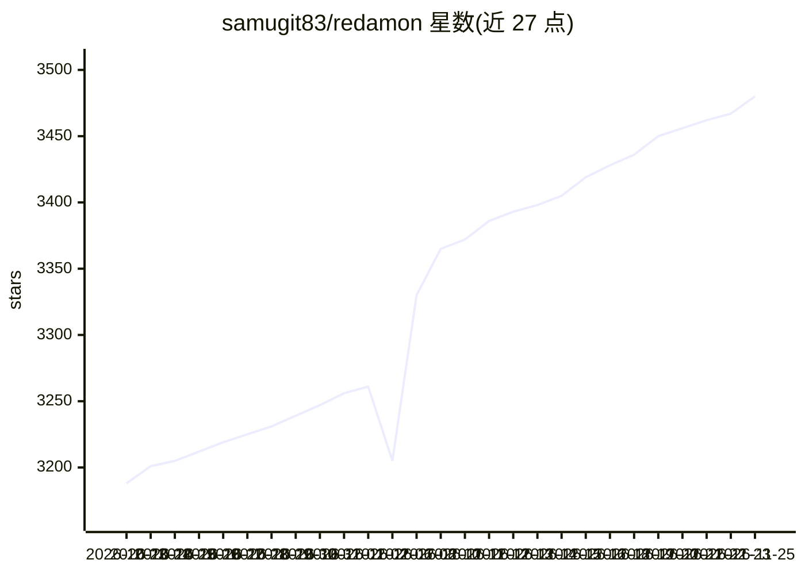

# samugit83/redamon

⭐ 3,480 · Python · MIT · 推送 2026-11-19 · [GitHub](https://github.com/samugit83/redamon) · [官网](https://www.redamon.org) · 组织维护

**自托管 AI 渗透测试平台：攻击面建图、授权利用、生成修复 PR**

自托管的多用户、多租户 AI 渗透测试平台，支持基于角色的访问控制、交战规则约束与只增审计日志。六阶段侦察引擎将攻击面（子域名、端口、端点、参数）并行扫描并合并为 Neo4j 知识图谱；AI agent 在 Kali 沙箱中验证 CVE 可利用性等，带人工审批门；CypherFix 分诊 agent 关联去重发现，CodeFix agent 克隆仓库实施修复并开 GitHub PR。集成 Metasploit、OpenVAS 等 100+ 安全工具与 185,000+ 检测规则，支持本地模型部署。

## 筛选速览

| 维度 | 判定 | 备注 |
|---|---|---|
| AI 角色 | `ai-native` | 本体是模型或模型工具 |
| 许可风险 | `permissive` | MIT |
| 部署形态 | `self-host` | docker 或自建部署 |
| 模型依赖 | local-ok | 支持本地模型 |
| 硬件要求 | — | 无带数字的原话,不猜 |
| 安装摩擦 | `low` | 无编译、无系统依赖或容器化 |
| 成熟度 | — | 结构信号不足 |

## 能力要点

- 攻击面并行侦察并合并为 Neo4j 知识图谱，可自然语言查询
- Kali 沙箱内自主利用，带人工审批门与审计日志
- CypherFix/CodeFix agent 关联分诊发现并生成修复 PR
- 支持接入 MCP server 作为工具，支持本地模型

## 适用场景

- 对自己拥有或获书面授权的基础设施做全范围安全评估
- 用知识图谱统一管理多工具侦察结果
- 让 AI 分诊安全发现并以 PR 形式交付修复供人工审核

## 场景标签

`网络安全` · 领域:学习与行业

## 证据(README 行号)

> L7:  RedAmon is a next-generation, enterprise-grade platform for AI-driven penetration testing, at the forefront of agen
> L63: RedAmon doesn't stop at finding vulnerabilities, it fixes them. The pipeline starts with a 6-phase reconnaissance e

## 星数曲线

2026-10-23 3,188 → 2026-11-25 3,480（+292）

---
*卡片 v1 · prompt 1.4 · 生成 2026-11-23 · 置信度 mid · 依据 README sha `2e22975f9259` · [字段定义](../../DATASET.md)*
