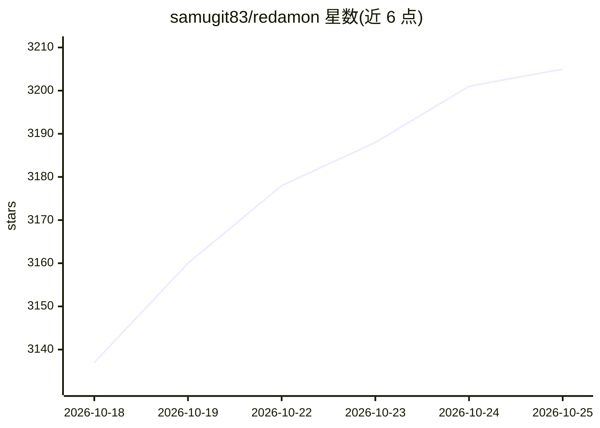

# samugit83/redamon

⭐ 3,212 · Python · MIT · 推送 2026-10-22 · [GitHub](https://github.com/samugit83/redamon) · [官网](https://www.redamon.org) · 个人维护

**自主 AI 渗透测试框架：侦察→利用→修复→开 PR 全流水线**

自托管的开源渗透测试框架，以 Docker 容器栈（webapp、Postgres、Neo4j、agent、Kali 沙箱等 7-11 个容器）部署。将多个安全扫描工具并行链接做侦察，结果合并为 Neo4j 攻击面知识图谱；随后自主 AI agent 验证 CVE 可利用性，CypherFix 分类去重漏洞发现，CodeFix agent 克隆仓库实现修复并提交 GitHub PR，关键步骤设有人工审批门。LLM 后端支持 OpenAI、Anthropic、OpenRouter、Bedrock 及 OpenAI 兼容端点（Ollama、vLLM、Groq 等）。限定授权安全测试用途。

## 筛选速览

| 维度 | 判定 | 备注 |
|---|---|---|
| AI 角色 | `ai-native` | 本体是模型或模型工具 |
| 许可风险 | `permissive` | MIT |
| 部署形态 | `self-host` | docker 或自建部署 |
| 模型依赖 | local-ok | 支持本地模型 |
| 硬件要求 | — | 无带数字的原话,不猜 |
| 安装摩擦 | `low` | 无编译、无系统依赖或容器化 |
| 成熟度 | — | 结构信号不足 |

## 能力要点

- 并行多工具侦察流水线，结果合并为 Neo4j 攻击面知识图谱
- CypherFix AI 分类去重 + CodeFix agent 自动修复并开 GitHub PR
- 关键步骤人工审批门，Kali 沙箱内执行利用
- MCP 双向：可接入任意 MCP server 作为工具，也可被 Claude Code 驱动

## 适用场景

- 授权范围内对企业资产做自动化渗透测试与漏洞验证
- 发现漏洞后自动生成修复补丁并提交 PR 供人工审核
- 将攻击面以知识图谱形式管理并用自然语言查询

## 场景标签

`网络安全` `知识图谱` · 领域:知识与检索

## 证据(README 行号)

> L7:  An autonomous AI framework that chains reconnaissance, exploitation, and post-exploitation into a single pipeline, 
> L61: RedAmon doesn't stop at finding vulnerabilities, it fixes them. The pipeline starts with a 6-phase reconnaissance e
> L175: - **LLM Providers** -- add API keys for OpenAI, Anthropic, OpenRouter, AWS Bedrock, or any OpenAI-compatible endpo

## 星数曲线

2026-10-18 3,137 → 2026-10-25 3,205（+68）

---
*卡片 v1 · prompt 1.4 · 生成 2026-10-20 · 置信度 mid · 依据 README sha `6309c2039ba6` · [字段定义](../../DATASET.md)*
