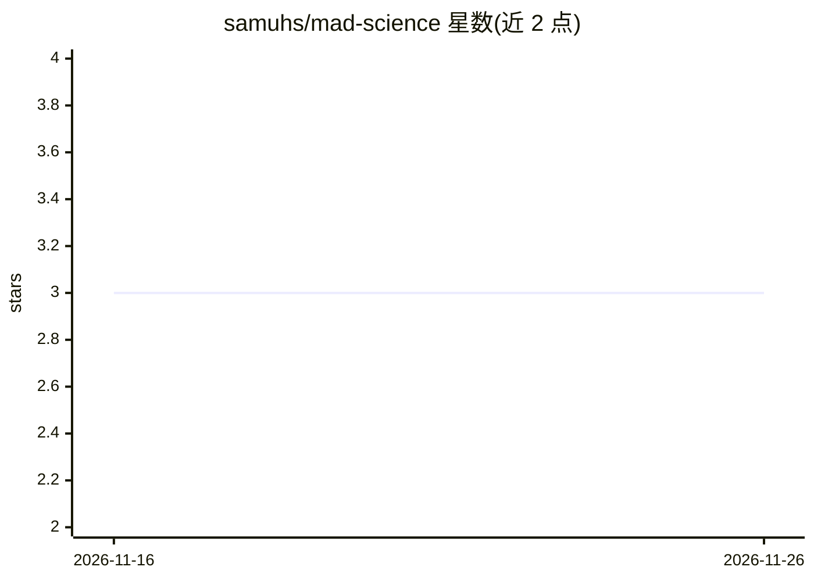

# samuhs/mad-science

⭐ 3 · Python · MIT · 推送 2026-11-11 · [GitHub](https://github.com/samuhs/mad-science) · [官网](https://skills.sh/samuhs/mad-science) · 个人维护

**教编码 agent 以假设驱动方式做数据科学/ML 实验的 14 个技能包**

一组面向编码 agent（Claude Code、Codex、GitHub Copilot、Cursor、Gemini CLI 等）的 Agent Skills，共 14 个，按 SKILL.md 格式分发。工作流为：访谈锐化假设、先写预期再验证、切分实验流水线、在 Jupyter notebook 中实现、经审查门禁检查可复现性/固定种子/数据泄漏后放行，最终可生成结构化科学文章。经插件市场安装可自动更新，或经 skills.sh 复制可编辑文件；实现类技能依赖 Jupyter，规划类技能适用于任意仓库。

## 筛选速览

| 维度 | 判定 | 备注 |
|---|---|---|
| AI 角色 | `ai-ecosystem` | LLM/agent 周边工具 |
| 许可风险 | `permissive` | MIT |
| 部署形态 | `library` | 以包/库形式分发 |
| 模型依赖 | locked-api |  |
| 硬件要求 | — | 无带数字的原话,不猜 |
| 安装摩擦 | `low` | 无编译、无系统依赖或容器化 |
| 成熟度 | — | 结构信号不足 |

## 能力要点

- 假设→契约→切片→notebook→审查的主流程，各步骤产出可供下一步消费的产物
- /exp-review 审查门禁检查固定种子、依赖锁定、数据泄漏与代码质量
- 同时支持 Claude Code/Codex/Copilot 插件市场与 skills.sh 跨 agent 安装
- /to-article 将实验结果转为结构化科学文章

## 适用场景

- 让编码 agent 按科研规范运行 ML 实验并保证可复现
- 在动手分析前强制写下可证伪假设与成功指标
- 把实验结果整理成论文级文档
- 对整个项目的证据与假设做批判性复审

## 场景标签

`编码 Agent` `科研工具` · 领域:编码与开发

## 证据(README 行号)

> L7: > **Hypothesis-driven data science** skills for coding agents (Claude Code, Codex,
> L11: **mad-science** is a set of 14 Agent Skills
> L117: /hypothesys → /to-doc → /experiment-pipeline → /let-it-rip → /exp-review

## 星数曲线

2026-11-16 3 → 2026-11-26 3（+0）

---
*卡片 v1 · prompt 1.4 · 生成 2026-11-21 · 置信度 high · 依据 README sha `cb5e71e31d30` · [字段定义](../../DATASET.md)*
