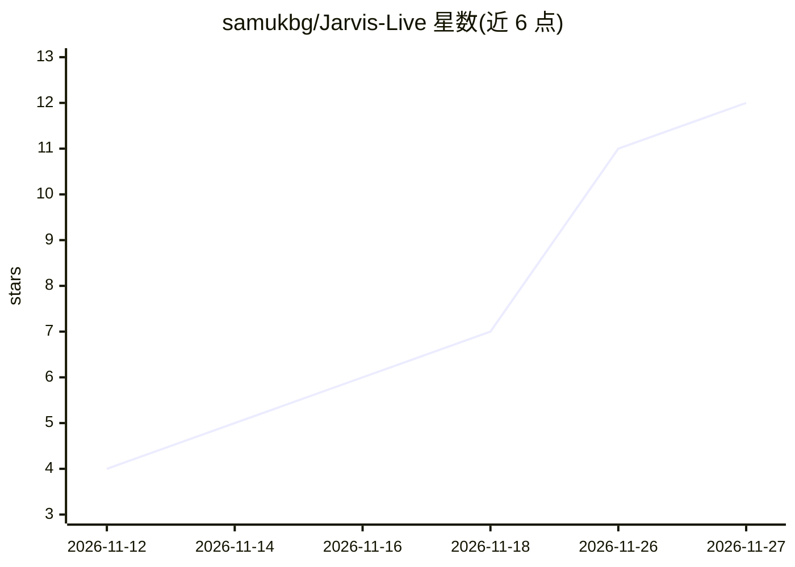

# samukbg/Jarvis-Live

⭐ 12 · JavaScript · MIT · 推送 2026-11-10 · [GitHub](https://github.com/samukbg/Jarvis-Live) · [官网](https://jarvis-live.xyz) · 个人维护

**自托管实时语音 AI 助手：照片级虚拟形象+委派编码 Agent 执行任务**

自托管的实时语音 AI 助手：全双工语音对话（Gemini Live，可选 LFM3-Audio 本地推理或 OpenAI Realtime），照片级 lip-sync 虚拟形象（AVTR-1，NVIDIA GPU 上 25fps，WebRTC 推流），支持打断与唤醒词。核心机制是委派编排：自动检测本机安装的 Claude Code、Codex、Antigravity、Hermes 等 Agent CLI，经 fast-path 或 LLM planner 路由请求，流式回报进度并朗读结果。响应生成实时卡片（天气/金融/日历/系统遥测），支持 Ollama 多服务器负载均衡、单张照片自建形象（XTTS 克隆语音），提供 iOS/Watch/Android 伴侣应用。

## 筛选速览

| 维度 | 判定 | 备注 |
|---|---|---|
| AI 角色 | `ai-native` | 本体是模型或模型工具 |
| 许可风险 | `permissive` | MIT |
| 部署形态 | `self-host` | docker 或自建部署 |
| 模型依赖 | local-ok | 支持本地模型 |
| 硬件要求 | — | 无带数字的原话,不猜 |
| 安装摩擦 | `low` | 无编译、无系统依赖或容器化 |
| 成熟度 | — | 结构信号不足 |

## 能力要点

- 全双工语音对话，支持 barge-in 打断与本地唤醒词
- 自动检测并编排 Claude Code/Codex/Antigravity/Hermes Agent CLI 执行实际任务
- AVTR-1 照片级实时虚拟形象，18 个内置形象，可单照片自建（XTTS 语音克隆）
- LFM3-Audio 本地语音引擎可选，支持 Ollama 多服务器负载均衡

## 适用场景

- 在自己的电脑上通过语音让 Agent 修改代码、运行命令、浏览网页
- 搭建无账号、无遥测的自托管语音助手并接入本地 LLM
- 用手机/手表随时随地访问家里电脑上的助手与任务

## 场景标签

`语音 Agent` `AI 助手` `编码 Agent` · 领域:编码与开发

## 证据(README 行号)

> L13: **Talk to your computer the way Tony Stark does.** You speak, Jarvis answers out loud in real time, a photoreal ava
> L35: - 🛠️ **It actually does things.** Jarvis orchestrates real coding agents (**Claude Code, OpenAI Codex, Google Antig
> L61: Jarvis **auto-detects** which agent CLIs are installed, lists their models, routes each request with a fast-path (s

## 星数曲线

2026-11-12 4 → 2026-11-27 12（+8）

---
*卡片 v1 · prompt 1.4 · 生成 2026-11-20 · 置信度 mid · 依据 README sha `105ca119171a` · [字段定义](../../DATASET.md)*
