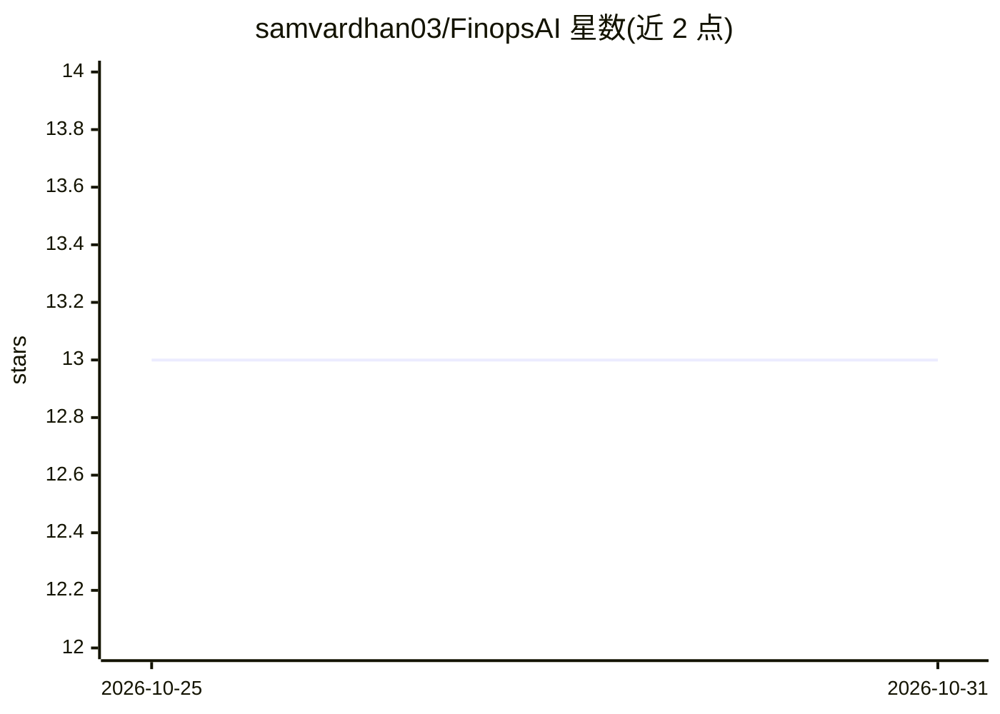

# samvardhan03/FinopsAI

⭐ 13 · Python · Apache-2.0 · 推送 2026-06-05 · [GitHub](https://github.com/samvardhan03/FinopsAI) · [官网](https://samvardhan03.github.io/FinopsAI/) · 个人维护

**多云成本优化平台：扫描 Azure/AWS/GCP 检测闲置资源并给 AI 建议**

面向企业的多云成本治理工具：统一扫描 Azure、AWS、GCP 共 14+ 类资源（孤儿快照、未挂载磁盘、僵尸 VM、闲置 IP 等），估算浪费金额。AI 部分采用 Isolation Forest 异常检测、Prophet 成本预测与优先级推荐（带努力/风险评级）；另含 YAML 策略引擎、审批流程与 NetworkX 依赖图安全删除分析。输出 HTML/JSON/CSV 报告与 Slack 通知，以 pip 包与 Click+Rich CLI 形式提供 Python API。

## 筛选速览

| 维度 | 判定 | 备注 |
|---|---|---|
| AI 角色 | `ai-enhanced` | 去掉 AI 部分产品仍成立 |
| 许可风险 | `permissive` | Apache-2.0 |
| 部署形态 | `library` | 以包/库形式分发 |
| 模型依赖 | — | README 未给出锁定关系 |
| 硬件要求 | — | 无带数字的原话,不猜 |
| 安装摩擦 | `low` | 无编译、无系统依赖或容器化 |
| 成熟度 | — | 结构信号不足 |

## 能力要点

- Azure/AWS/GCP 统一接口扫描 14+ 类闲置资源
- Isolation Forest 异常检测 + Prophet 成本预测
- YAML 策略引擎与审批工作流
- 依赖图驱动的安全删除分析，输出 HTML/JSON/CSV 与 Slack 通知

## 适用场景

- 企业盘点多云账户中的孤儿资源与浪费支出
- 预测云支出趋势并获取优先级排序的节省建议
- 通过策略引擎对资源删除执行治理与审批

## 场景标签

 · 领域:云成本管理/FinOps

## 证据(README 行号)

> L26: |**AI/ML Engine**|Isolation Forest anomaly detection + Prophet cost forecasting|
> L15: > **Stop paying for cloud resources nobody uses.** FinOps AI scans your multi-cloud

## 星数曲线

2026-10-25 13 → 2026-10-31 13（+0）

---
*卡片 v1 · prompt 1.4 · 生成 2026-10-31 · 置信度 mid · 依据 README sha `29ab914b524f` · [字段定义](../../DATASET.md)*
