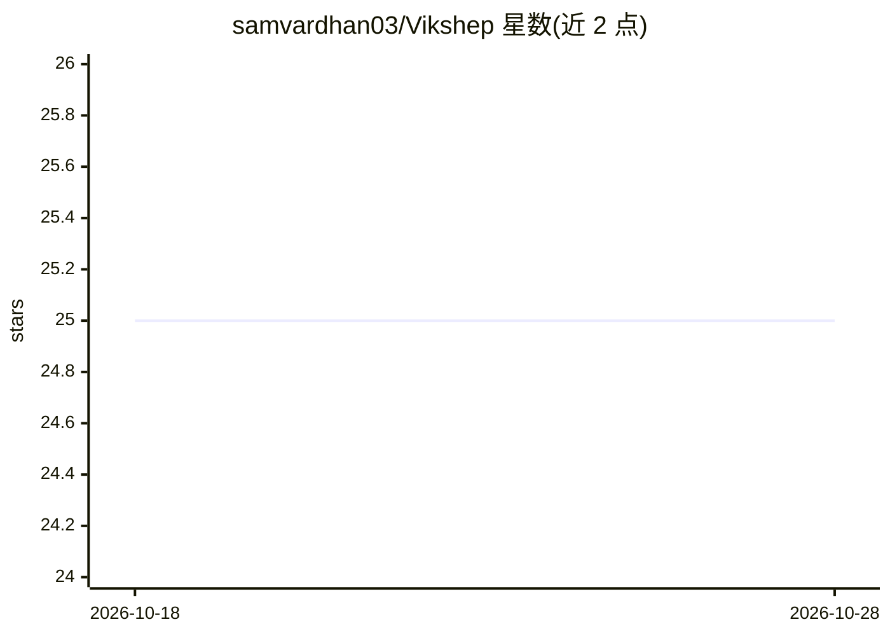

# samvardhan03/Vikshep

⭐ 25 · TypeScript · AGPL-3.0 · 推送 2026-10-25 · [GitHub](https://github.com/samvardhan03/Vikshep) · [官网](https://vikshep.vercel.app/) · 个人维护

**面向物理学的确定性小波散射特征提取与去相关标注工具链**

为高能物理等科学数据提供固定的（非学习的）特征平面：将 Geant4 事件栅格化为 2-D (phi×theta) 网格，计算小波散射变换 S0/S1/S2 与尺度无关比值 r2，再在其上训练带 DisCo 加权 dCorr² 惩罚的标注与校准模型，用于缓解喷注标注中的质量雕刻问题。开放 AGPL 控制平面（本仓库）+ AGPL 开源 Rust 计算核心（CPU 路径），GPU 内核为专有后端且未发布。未装 vikshep_compute 时回退到逐事件聚合标量与 Pearson 代理梯度。支持 Geant4 CSV、ROOT、HDF5、The Well 数据加载，另含 MCP 数据平面与 agent 配方。

## 筛选速览

| 维度 | 判定 | 备注 |
|---|---|---|
| AI 角色 | `ai-native` | 本体是模型或模型工具 |
| 许可风险 | `dual` | AGPL-3.0 |
| 部署形态 | `library` | 以包/库形式分发 |
| 模型依赖 | — | README 未给出锁定关系 |
| 硬件要求 | — | 无带数字的原话,不猜 |
| 安装摩擦 | `high` | 编译与系统依赖俱全 |
| 成熟度 | `idea` | |

## 能力要点

- 固定解析 Morlet 小波散射变换（S0/S1/S2、r2 比值），特征提取阶段无学习参数
- 精确加权 dCorr² 梯度的 DisCo 去相关惩罚训练标注/校准模型
- 跨平台位级一致性（VDS-1 一致性套件，Linux/macOS/Windows CI 验证）
- SHA3-256 OID 张量级溯源记录，四种数据加载器（Geant4 CSV/ROOT/HDF5/The Well）

## 适用场景

- 在喷注标注中避免学习式判别器造成的质量雕刻伪信号
- 从 Geant4 模拟输出提取可复现的散射特征并训练去相关分类器
- 为下游分类器/异常检测/似然拟合提供确定性输入特征

## 场景标签

 · 领域:物理/高能物理科学计算

## 证据(README 行号)

> L12: Vikshep is a **deterministic feature-extraction plane** for scientific data — not a classifier,
> L22: trains calibration and DisCo-penalised tagging models on those features with the exact weighted
> L49: A neural jet tagger trained on high-level kinematic features learns the jet mass implicitly.

## 星数曲线

2026-10-18 25 → 2026-10-28 25（+0）

---
*卡片 v1 · prompt 1.4 · 生成 2026-10-26 · 置信度 mid · 依据 README sha `78ab73037042` · [字段定义](../../DATASET.md)*
