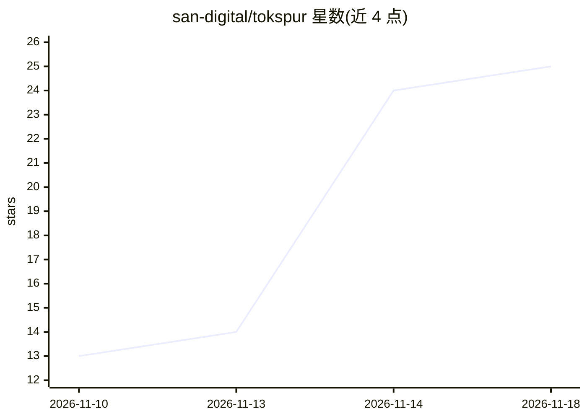

# san-digital/tokspur

⭐ 25 · C++ · Apache-2.0 · 推送 2026-11-17 · [GitHub](https://github.com/san-digital/tokspur) · [官网](https://tokspur.com) · 组织维护

**Mac 本地运行 Qwen3.8 Flash-Next 的私有推理引擎**

面向 Apple Silicon（M5 Max/128GB 统一内存）的本地 LLM 推理引擎：以原生 Metal worker 运行 Qwen3.8 Flash-Next 的 GGUF/Planar Pack v3 权重，提供 OpenAI 兼容的 chat API（默认 64K、可选 128K 上下文，8,192 输出 token 上限可调至 32,768），支持 MTP 或可选 DFlash2 投机解码加速、默认开启思考模式并可配置 reasoning_effort 与 thinking_budget。通过 curl 安装脚本安装，或从源码构建（需 Xcode/Metal、Python 3.12、Rust）。限制：硬件要求为 M5 Max 40 核 GPU、128GB 内存、macOS 27 及以上。

## 筛选速览

| 维度 | 判定 | 备注 |
|---|---|---|
| AI 角色 | `ai-ecosystem` | LLM/agent 周边工具 |
| 许可风险 | `permissive` | Apache-2.0 |
| 部署形态 | `None` |  |
| 模型依赖 | local-ok | 支持本地模型 |
| 硬件要求 | — | 无带数字的原话,不猜 |
| 安装摩擦 | `low` | 无编译、无系统依赖或容器化 |
| 成熟度 | — | 结构信号不足 |

## 能力要点

- 原生 Metal worker 本地推理，OpenAI 兼容 chat API（127.0.0.1:18081/v1）
- MTP 与可选 DFlash2 投机解码（含 CJK 优化选项）
- 64K 默认 / 128K 可选上下文，输出上限 32,768 token
- tokspur pull 下载权重并 SHA-256 校验，无需额外打包步骤

## 适用场景

- 在 Mac 上私有运行大模型进行聊天与代码生成
- 通过 OpenAI 兼容 API 让本地客户端接入自建模型服务
- 需要长上下文（128K）的本地推理工作负载

## 场景标签

`推理引擎` · 领域:训练与推理

## 证据(README 行号)

> L12: Tokspur runs Qwen3.8 Flash-Next locally on a Mac. It uses a native Metal worker and serves an OpenAI-compatible cha
> L14: Tokspur needs an Apple M5 Max with a 40-core GPU, 128 GB of unified memory and macOS 27 or later. Run the installer

## 星数曲线

2026-11-10 13 → 2026-11-18 25（+12）

---
*卡片 v1 · prompt 1.4 · 生成 2026-11-18 · 置信度 high · 依据 README sha `6bd83b68f58c` · [字段定义](../../DATASET.md)*
