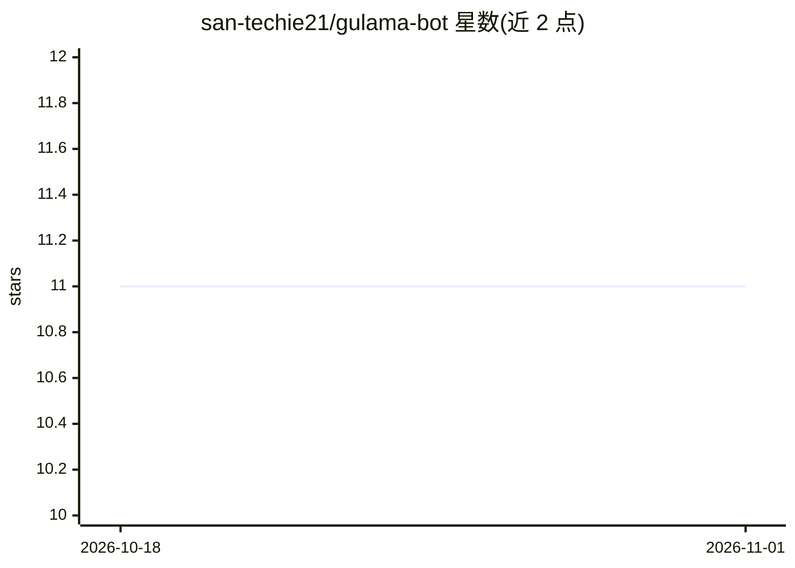

# san-techie21/gulama-bot

⭐ 11 · Python · MIT · 推送 2026-02-17 · [GitHub](https://github.com/san-techie21/gulama-bot) · [官网](https://pypi.org/project/gulama/) · 个人维护

**安全优先的自托管个人 AI agent，支持 100+ LLM 接入**

面向个人用户的开源自托管 AI agent，以 pip 包与 Docker 两种方式安装，通过 gulama setup 向导配置。核心机制：19 个内置技能（文件、shell、浏览器、邮件、日历、语音、智能家居等）、10 个通信渠道（CLI/Telegram/Discord/Slack/WhatsApp/Matrix/Teams 等）、AES-256-GCM 凭据加密、沙箱化技能执行与提示注入检测等 15+ 安全机制、5 级自主权限、RAG 记忆（ChromaDB）与 MCP 客户端/服务端。LLM 接入经 LiteLLM 支持 100+ 提供商，可经 Ollama 完全离线运行。限制：需 Python 3.12+ 与 LLM API key（或本地 Ollama），配置项较多。

## 筛选速览

| 维度 | 判定 | 备注 |
|---|---|---|
| AI 角色 | `ai-native` | 本体是模型或模型工具 |
| 许可风险 | `permissive` | MIT |
| 部署形态 | `self-host` | docker 或自建部署 |
| 模型依赖 | local-ok | 支持本地模型 |
| 硬件要求 | — | 无带数字的原话,不猜 |
| 安装摩擦 | `low` | 无编译、无系统依赖或容器化 |
| 成熟度 | — | 结构信号不足 |

## 能力要点

- 19 个内置技能运行于安全沙箱并有策略引擎授权
- AES-256-GCM 加密凭据与记忆，15+ 安全机制内置于核心
- 10 个通信渠道，含 Matrix 端到端加密与语音唤醒
- 经 LiteLLM 支持 100+ LLM 提供商，可配合 Ollama 本地离线运行

## 适用场景

- 在自有设备上运行一个能操作文件、邮件、日程与浏览器的个人 AI 助手
- 从 Telegram/Discord/WhatsApp 等日常聊天工具操控同一个 agent
- 不依赖云厂商、数据留在本地的自托管 AI 助手方案

## 场景标签

`AI 助手` · 领域:对话与助手

## 证据(README 行号)

> L25: Personal AI agents handle your files, emails, credentials, and conversations. Most treat security as an afterthough
> L44: - 🎤 **Voice Wake Word** — Always-on "Hey Gulama" listening via Picovoice. Detects the wake word, captures speech, p

## 星数曲线

2026-10-18 11 → 2026-11-01 11（+0）

---
*卡片 v1 · prompt 1.4 · 生成 2026-11-01 · 置信度 high · 依据 README sha `553e092b9635` · [字段定义](../../DATASET.md)*
