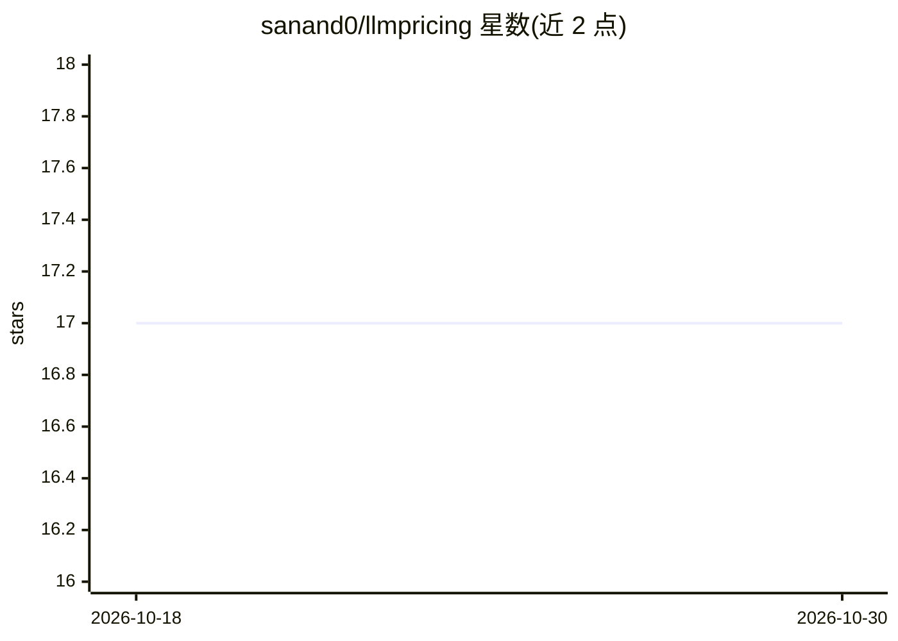

# sanand0/llmpricing

⭐ 17 · Python · MIT · 推送 2026-10-25 · [GitHub](https://github.com/sanand0/llmpricing) · [官网](https://sanand0.github.io/llmpricing/) · 个人维护

**LLM 成本与质量对比图：识别帕累托前沿模型**

基于 LMSYS Arena ELO 分数与代表性 API 输入价格（每百万 token）构建的 LLM 成本-质量散点图，标记帕累托最优（绿）与次优（红）模型，提供月份滑块观察前沿随时间的演变。定价优先采用第一方或主流供应商的标准价格，遗留模型保留历史价格与结束日期，无可用价格的留空。README 列出 ArtificialAnalysis.ai 作为替代。

## 筛选速览

| 维度 | 判定 | 备注 |
|---|---|---|
| AI 角色 | `ai-knowledge` | 知识聚合/清单类 |
| 许可风险 | `permissive` | MIT |
| 部署形态 | `None` |  |
| 模型依赖 | — | README 未给出锁定关系 |
| 硬件要求 | — | 无带数字的原话,不猜 |
| 安装摩擦 | `low` | 无编译、无系统依赖或容器化 |
| 成熟度 | — | 结构信号不足 |

## 能力要点

- 以 ELO 分数与代表 API 输入价格构建成本-质量对比图
- 标记帕累托最优/次优模型（绿/红）
- 月份滑块展示前沿随时间演变
- 遗留模型保留历史价格与元数据但 ELO 留空

## 适用场景

- 挑选价格与质量帕累托最优的 LLM
- 跟踪 LLM 成本下降与质量前沿的时间变化
- 对比多家供应商模型的经济性

## 场景标签

`模型评测` · 领域:评测与运维

## 证据(README 行号)

> L12: the ELO score on the LMSYS Leaderboard.
> L16: This chart shows the cost and quality of each LLM.

## 星数曲线

2026-10-18 17 → 2026-10-30 17（+0）

---
*卡片 v1 · prompt 1.4 · 生成 2026-10-29 · 置信度 high · 依据 README sha `fab2b385cc45` · [字段定义](../../DATASET.md)*
