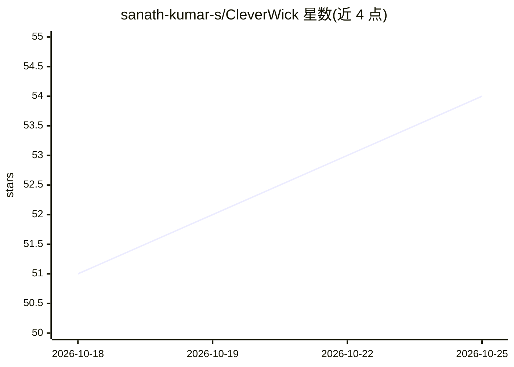

# sanath-kumar-s/CleverWick

⭐ 56 · JavaScript · 推送 2026-03-30 · [GitHub](https://github.com/sanath-kumar-s/CleverWick) · 个人维护

**离线本地运行的桌面 AI 聊天助手（GGUF/llama.cpp）**

基于 Electron 41 + Next.js 16 的桌面 AI 助手，内置 llama.cpp（llama-server）做 CPU 推理，加载 models/ 目录下的 GGUF 格式模型（如 Qwen 2.5、Phi-3、Mistral）进行本地聊天。设计目标是超便携与零安装：整个系统可放在 U 盘上，插入 Windows 电脑直接运行，无需在主机安装 Node.js 或 Python，数据不出本地。会话与记忆存储在便携驱动器上。首次从 GitHub 克隆需运行 setup.bat 还原目录与依赖，之后通过 start_pocketnode.bat 启动。

## 筛选速览

| 维度 | 判定 | 备注 |
|---|---|---|
| AI 角色 | `ai-native` | 本体是模型或模型工具 |
| 许可风险 | `none` | — |
| 部署形态 | `None` |  |
| 模型依赖 | local-ok | 支持本地模型 |
| 硬件要求 | — | 无带数字的原话,不猜 |
| 安装摩擦 | `low` | 无编译、无系统依赖或容器化 |
| 成熟度 | — | 结构信号不足 |

## 能力要点

- 100% 离线运行，会话与处理均在本地
- 支持 GGUF 格式模型（Qwen 2.5、Phi-3、Mistral 等）
- 可从 U 盘直接运行，无需主机安装 Node.js/Python
- 自动适配可用 CPU 线程

## 适用场景

- 在无网络环境下使用本地 LLM 聊天
- 用 U 盘携带 AI 助手到任意 Windows 电脑使用
- 对数据隐私敏感的本地 AI 对话

## 场景标签

`AI 助手` `聊天机器人` · 领域:对话与助手

## 证据(README 行号)

> L7: **Cleverwick** is a lightweight, self-contained Artificial Intelligence application designed to run entirely offline
> L25: * **AI Engine**: Llama.cpp (via `llama-server`) for efficient CPU-based inference.

## 星数曲线

2026-10-18 51 → 2026-10-25 54（+3）

---
*卡片 v1 · prompt 1.4 · 生成 2026-10-24 · 置信度 high · 依据 README sha `2ca480d9d536` · [字段定义](../../DATASET.md)*
