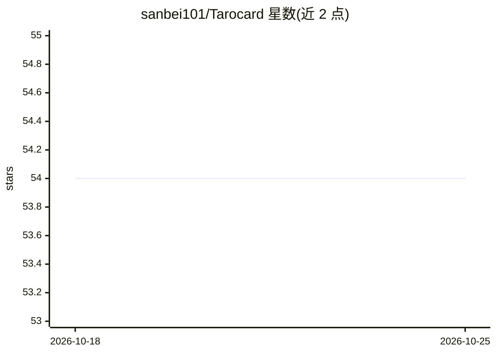

# sanbei101/Tarocard

⭐ 54 · Vue · 推送 2026-10-22 · [GitHub](https://github.com/sanbei101/Tarocard) · [官网](https://tarocard.pages.dev) · 个人维护 · 中文 README

**给塔罗牌爱好者的 Vue 3 塔罗牌 AI 预测趣味应用**

基于 Vue 3 + Vite + Tailwind CSS 实现的塔罗牌趣味应用：随机排列塔罗牌、支持选择与取消选择、完成选择后显示结果，并带响应式设计。README 提到需要配置 AI 推理的 API key（env.example 复制为 .env），AI 预测细节未在可见文本中展开。安装方式为 git clone 源码后 pnpm install、pnpm dev 运行，面向个人娱乐使用者。

## 筛选速览

| 维度 | 判定 | 备注 |
|---|---|---|
| AI 角色 | `ai-native` | 本体是模型或模型工具 |
| 许可风险 | `none` | — |
| 部署形态 | `library` | 以包/库形式分发 |
| 模型依赖 | — | README 未给出锁定关系 |
| 硬件要求 | — | 无带数字的原话,不猜 |
| 安装摩擦 | `low` | 无编译、无系统依赖或容器化 |
| 成熟度 | — | 结构信号不足 |

## 能力要点

- 随机排列塔罗牌并展示视觉效果
- 支持选择/取消选择塔罗牌，完成后显示结果
- 响应式设计适配不同设备
- 通过 .env 配置 AI 推理 API key

## 适用场景

- 抽取塔罗牌并查看 AI 给出的趣味解读
- 在手机或电脑上体验塔罗牌选择流程

## 场景标签

`AI 写作` · 领域:内容生成

## 证据(README 行号)

> L3: 一个基于 Vue 3 的塔罗牌趣味应用
> L34: # 填写ai推理的api key

## 星数曲线

2026-10-18 54 → 2026-10-25 54（+0）

---
*卡片 v1 · prompt 1.4 · 生成 2026-10-24 · 置信度 mid · 依据 README sha `7aded92bc695` · [字段定义](../../DATASET.md)*
