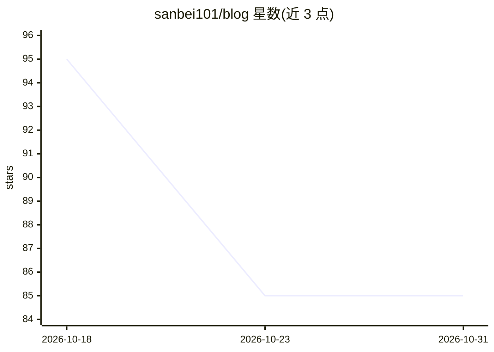

# sanbei101/blog

⭐ 85 · MIT · 推送 2026-10-07 · [GitHub](https://github.com/sanbei101/blog) · [官网](https://blog.sanbei101.cn) · 个人维护 · 中文 README

**Go 全栈工程师的 AI 人机协同工程实践博客**

个人技术博客（Hugo 构建，OINK 主题，blog.sanbei101.cn），主题为人机协同开发下的后端与全栈工程实践。内容分三个板块：整洁与规范（标准库优先、sqlc 替代 ORM、Linter 门禁）、工具与约束（gopls 为模型接入 AST 符号分析、rtk 终端降噪守护上下文）、迭代与测试（OpenAPI/Orval 契约对齐、pprof 性能调优、边界对拍测试）。另含算法笔记与环境踩坑记录，支持暗色模式与离线搜索。

## 筛选速览

| 维度 | 判定 | 备注 |
|---|---|---|
| AI 角色 | `ai-knowledge` | 知识聚合/清单类 |
| 许可风险 | `permissive` | MIT |
| 部署形态 | `None` |  |
| 模型依赖 | — | README 未给出锁定关系 |
| 硬件要求 | — | 无带数字的原话,不猜 |
| 安装摩擦 | `low` | 无编译、无系统依赖或容器化 |
| 成熟度 | — | 结构信号不足 |

## 能力要点

- 以 sqlc 静态生成替代运行时 ORM 的工程主张
- 借助 gopls 语言服务器为模型注入 AST 与跨包符号分析
- rtk 终端降噪过滤冗余控制台输出以守护上下文
- OpenAPI + Orval 实现前后端契约静态编译

## 适用场景

- 查阅 AI 编程辅助下的 Go 后端工程实践文章
- 了解代码基座整洁与质量门禁的落地方法
- 参考性能调优与测试排错的具体工作流

## 场景标签

`教程课程` · 领域:学习与行业

## 证据(README 行号)

> L11: > 很多关于 AI 编程的讨论往往停留在"哪个工具好用"或脱离工程现场的泛泛而谈。但当系统规模变大、业务充满并发与副作用时,真正决定上限的不是让模型自由发挥,而是工程师如何**铺平代码基座、明确接口契约并建立确定性的验证闭环**。
> L47: - **内容形态**:涵盖系统工程专栏、全栈落地实践、算法笔记与环境踩坑记录。

## 星数曲线

2026-10-18 95 → 2026-10-31 85（-10）

---
*卡片 v1 · prompt 1.4 · 生成 2026-10-24 · 置信度 mid · 依据 README sha `df59a7cc4b58` · [字段定义](../../DATASET.md)*
