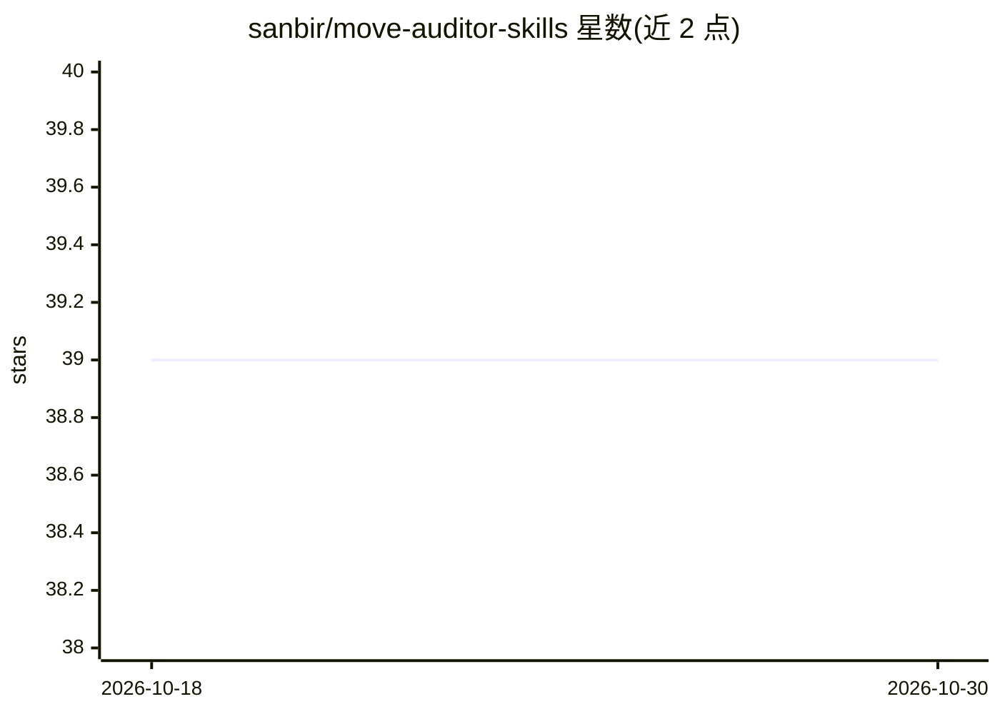

# sanbir/move-auditor-skills

⭐ 39 · MIT · 推送 2026-03-23 · [GitHub](https://github.com/sanbir/move-auditor-skills) · [官网](https://crypto.training/) · 个人维护

**面向 Sui Move 包安全审计的 AI agent 技能集**

一套安全审计技能（skill），供 Claude Code、Cursor、Codex、GitHub Copilot、Windsurf 等 AI 编码平台加载后对 Sui Move 代码包执行审计。技能覆盖 capability 泄漏与 witness 误用、共享对象竞态与 PTB 组合缺陷、对象所有权不变量、动态字段损坏、包升级与版本门控错误、kiosk/coin/treasury/vault 记账缺陷、过期 oracle 使用等问题。基于 pashov/skills v2 打包与工作流模型改编，仅一个 move-auditor 技能，定位为漏洞检测与威胁建模而非通用静态分析或风格检查。MIT 许可。

## 筛选速览

| 维度 | 判定 | 备注 |
|---|---|---|
| AI 角色 | `ai-knowledge` | 知识聚合/清单类 |
| 许可风险 | `permissive` | MIT |
| 部署形态 | `None` |  |
| 模型依赖 | — | README 未给出锁定关系 |
| 硬件要求 | — | 无带数字的原话,不猜 |
| 安装摩擦 | `low` | 无编译、无系统依赖或容器化 |
| 成熟度 | — | 结构信号不足 |

## 能力要点

- 针对 Sui Move 对象中心运行时的安全审计技能
- 覆盖 capability、共享对象、PTB、升级、对象记账等攻击面
- 支持 5 个 AI 编码平台（Claude Code/Cursor/Codex/Copilot/Windsurf）
- 基于 pashov/skills v2 打包模型改编

## 适用场景

- 我在用 Claude Code 或 Cursor 审计 Sui Move 合约时加载该技能获取安全反馈
- 按攻击向量清单排查 Move 包的 capability 与共享对象问题
- 对指定文件运行 move-auditor 技能做漏洞检测

## 场景标签

`代码审查` · 领域:编码与开发

## 证据(README 行号)

> L3: > AI-powered Sui Move security skills for auditing packages that live in an object-centric runtime, not an EVM accou
> L45: |Skill|Description|
> L47: |move-auditor|Fast security feedback for Sui Move packages with attack-vector coverage for capabilities, shared obj

## 星数曲线

2026-10-18 39 → 2026-10-30 39（+0）

---
*卡片 v1 · prompt 1.4 · 生成 2026-10-25 · 置信度 high · 依据 README sha `1391b3097540` · [字段定义](../../DATASET.md)*
