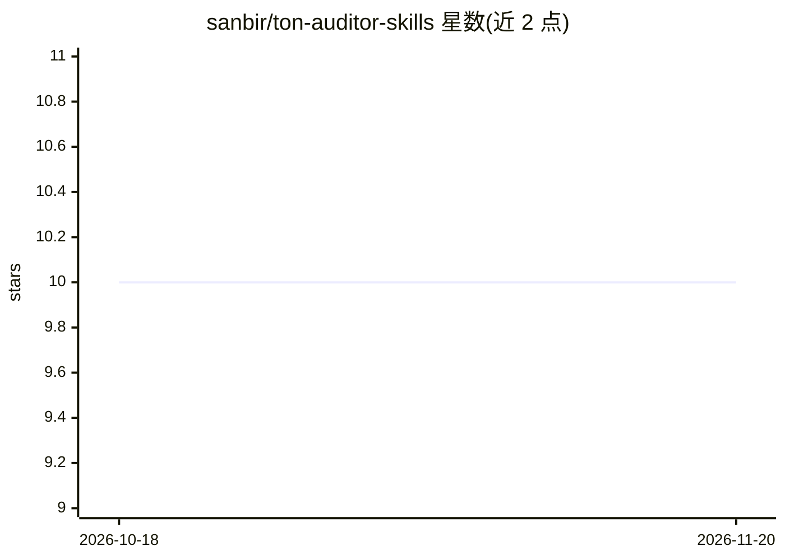

# sanbir/ton-auditor-skills

⭐ 10 · MIT · 推送 2026-03-23 · [GitHub](https://github.com/sanbir/ton-auditor-skills) · [官网](https://crypto.training/) · 个人维护

**面向开发者的 TON 智能合约 AI 安全审计技能包**

为 Claude Code、Cursor、Codex 等 AI 编码平台提供的 TON 合约安全审计技能集，基于 pashov/skills 的 v2 打包与工作流模型改造。聚焦 FunC 与 Tact 合约中异步执行模型特有的漏洞类别：异步消息顺序与部分执行、bounce 消息处理、accept_message 位置与 gas 消耗、send-mode 误用、Jetton 校验、重放保护、存储打包/升级状态损坏等。提供 ton-auditor 技能，通过提示词在代码库或指定文件上运行多个 agent 完成审计。MIT 许可。

## 筛选速览

| 维度 | 判定 | 备注 |
|---|---|---|
| AI 角色 | `ai-native` | 本体是模型或模型工具 |
| 许可风险 | `permissive` | MIT |
| 部署形态 | `None` |  |
| 模型依赖 | — | README 未给出锁定关系 |
| 硬件要求 | — | 无带数字的原话,不猜 |
| 安装摩擦 | `low` | 无编译、无系统依赖或容器化 |
| 成熟度 | — | 结构信号不足 |

## 能力要点

- 单个 ton-auditor 技能覆盖异步消息流、bounce 逻辑、Jetton 处理、gas 模式与存储/升级风险
- 支持 Claude Code、Cursor、Codex、GitHub Copilot、Windsurf 五个平台
- 聚焦 TON 异步执行模型的漏洞检测，非通用风格检查
- 基于 pashov/skills 的 v2 打包与工作流模型适配

## 适用场景

- 在上线前对 FunC/Tact 合约做异步与 gas 类漏洞扫描
- 审计 bounced-message 处理与 Jetton 钱包校验逻辑
- 让多个 AI agent 对指定合约文件并行给出安全反馈

## 场景标签

`网络安全` `代码审查` · 领域:编码与开发

## 证据(README 行号)

> L3: > AI-powered TON security skills for contracts where asynchronous message flow, bounce handling, and gas semantics a
> L30: This repo is for **TON smart contract security** across FunC and Tact.
> L48: |ton-auditor|Fast security feedback for FunC and Tact contracts with coverage for async message flow, bounce logic,

## 星数曲线

2026-10-18 10 → 2026-11-20 10（+0）

---
*卡片 v1 · prompt 1.4 · 生成 2026-11-19 · 置信度 high · 依据 README sha `91d543cc6895` · [字段定义](../../DATASET.md)*
