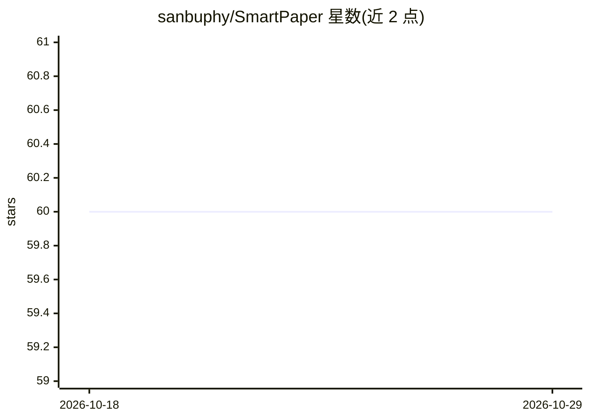

# sanbuphy/SmartPaper

⭐ 60 · Python · Apache-2.0 · 推送 2026-08-03 · [GitHub](https://github.com/sanbuphy/SmartPaper) · 个人维护 · 中文 README

**帮研究者快速阅读论文的 LLM 分析助手**

通过集成多种国内外大模型 API（OpenAI、DeepSeek、文心一言、Kimi、豆包、智谱等），自动分析学术论文并生成 Markdown 结构化报告。输入支持单个 PDF、PDF 文件夹批量处理与 arXiv URL 自动转换；提供单提示词模板（含总结、方法论、结果、VLM 图像描述/OCR 等多模板）与开发中的 Agent 对话模式。交互方式为命令行（标准/流式）和 Streamlit 图形界面，支持自定义提示词与文档转换器。项目自述处于高速迭代阶段，API 可能变动。

## 筛选速览

| 维度 | 判定 | 备注 |
|---|---|---|
| AI 角色 | `ai-native` | 本体是模型或模型工具 |
| 许可风险 | `permissive` | Apache-2.0 |
| 部署形态 | `library` | 以包/库形式分发 |
| 模型依赖 | locked-api |  |
| 硬件要求 | — | 无带数字的原话,不猜 |
| 安装摩擦 | `low` | 无编译、无系统依赖或容器化 |
| 成熟度 | `idea` | |

## 能力要点

- 接入 OpenAI/DeepSeek/文心一言/Kimi/豆包/智谱等多种 LLM API
- PDF/文件夹/arXiv URL 多种输入，批量分析论文
- 8 种提示词模板（含 VLM 图像描述与 OCR 模板），支持自定义
- 命令行与 Streamlit 图形界面两种交互方式

## 适用场景

- 我拿到一篇 arXiv 论文想快速得到结构化总结报告
- 批量处理一个文件夹里的 PDF 论文并生成分析报告
- 换不同 LLM 提供商来分析同一篇论文

## 场景标签

`科研工具` `文档问答` · 领域:知识与检索

## 证据(README 行号)

> L22: **SmartPaper** 是一个领先的智能论文阅读和分析工具，通过集成多种大语言模型 (LLM) 接口，自动分析学术论文内容并生成高质量的结构化报告。无论您是研究人员、学生还是对最新研究感兴趣的专业人士，SmartPaper 
> L29: - **国内外主流大模型**：
> L46:  - **单提示词模式**：使用精心设计的提示词模板高效分析

## 星数曲线

2026-10-18 60 → 2026-10-29 60（+0）

---
*卡片 v1 · prompt 1.4 · 生成 2026-10-24 · 置信度 high · 依据 README sha `c2d7b512bcb9` · [字段定义](../../DATASET.md)*
