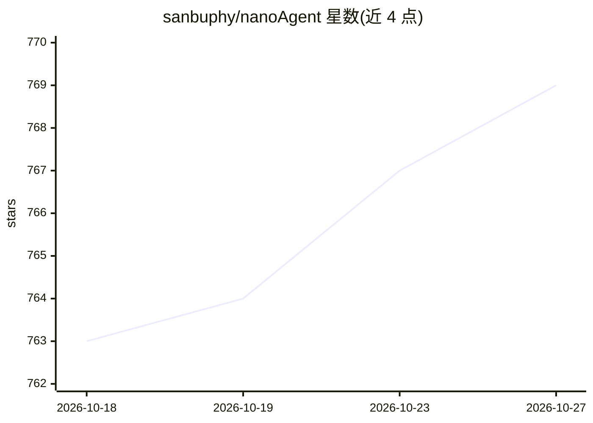

# sanbuphy/nanoAgent

⭐ 769 · Python · MIT · 推送 2026-03-13 · [GitHub](https://github.com/sanbuphy/nanoAgent) · 个人维护 · 中文 README

**约百行 Python 的极简 AI agent 参考实现，供学习 agent 原理**

基于 OpenAI function calling 的最小 AI agent 实现，约 100 行代码：接收用户任务，自主选择并执行 bash 命令、读文件、写文件三类工具，循环调用模型直至任务完成；对畸形 JSON 参数或未知工具调用返回显式工具错误而不中断循环。支持通过环境变量配置 API key、base URL 与模型名，从而兼容其他 OpenAI 兼容接口。README 指向同作者的 nanoMCP 项目作为进一步学习 MCP 的路径。供希望理解 agent 运行机制的开发者阅读与运行。

## 筛选速览

| 维度 | 判定 | 备注 |
|---|---|---|
| AI 角色 | `ai-ecosystem` | LLM/agent 周边工具 |
| 许可风险 | `permissive` | MIT |
| 部署形态 | `library` | 以包/库形式分发 |
| 模型依赖 | — | README 未给出锁定关系 |
| 硬件要求 | — | 无带数字的原话,不猜 |
| 安装摩擦 | `low` | 无编译、无系统依赖或容器化 |
| 成熟度 | — | 结构信号不足 |

## 能力要点

- 约 100 行代码实现完整的工具调用 agent 循环
- 三类内置工具：execute_bash / read_file / write_file
- 畸形参数与未知工具调用不崩溃，作为显式错误回传模型
- OPENAI_BASE_URL / OPENAI_MODEL 环境变量可配置接口与模型

## 适用场景

- 阅读源码理解 function calling agent 的核心循环
- 作为最小骨架改造出自己的工具调用 agent
- 在本地让 agent 执行文件操作与 bash 任务

## 场景标签

`Agent 框架` `教程课程` · 领域:Agent 开发

## 证据(README 行号)

> L7: The simplest way to build an agent that can interact with your system.
> L9: A minimal implementation of an AI agent using OpenAI's function calling. The agent can execute bash commands, read f
> L59: That's it. ~100 lines of code.

## 星数曲线

2026-10-18 763 → 2026-10-27 769（+6）

---
*卡片 v1 · prompt 1.4 · 生成 2026-10-22 · 置信度 high · 依据 README sha `34dfe091a5c2` · [字段定义](../../DATASET.md)*
