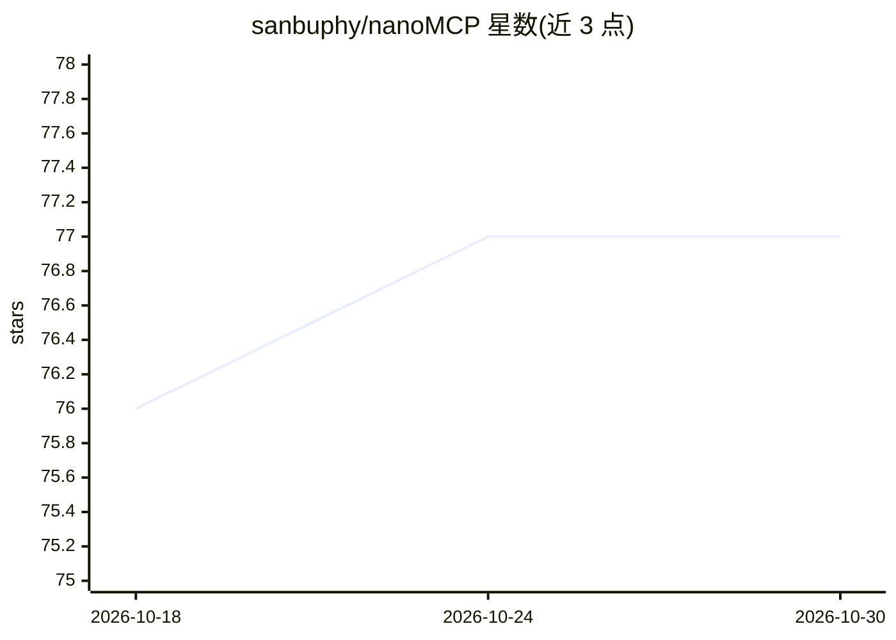

# sanbuphy/nanoMCP

⭐ 77 · Python · 推送 2026-03-12 · [GitHub](https://github.com/sanbuphy/nanoMCP) · 个人维护 · 中文 README

**给开发者的 MCP 协议最小可读示例集（约 200 行 Python）**

用 Python 编写的 MCP（Model Context Protocol）最小演示仓库：包含暴露玩具工具的 MCP 服务器，以及 stdio、SSE、Streamable HTTP 三种传输各自独立端到端的客户端示例；客户端把 MCP 工具转换为 OpenAI 工具并运行 function-calling 循环。另含 Tavily MCP 的本地 stdio（npx）与远程 Streamable HTTP 接入示例，docs/ 目录提供中英文 MCP 协议笔记。实现 JSON-RPC 2.0、initialize 握手、tools/list、tools/call，协议版本 2024-11-05。通过 OpenAI SDK 调用 LLM，兼容 StepFun 环境变量回退；限制为最大迭代次数后停止。

## 筛选速览

| 维度 | 判定 | 备注 |
|---|---|---|
| AI 角色 | `ai-ecosystem` | LLM/agent 周边工具 |
| 许可风险 | `none` | — |
| 部署形态 | `library` | 以包/库形式分发 |
| 模型依赖 | — | README 未给出锁定关系 |
| 硬件要求 | — | 无带数字的原话,不猜 |
| 安装摩擦 | `low` | 无编译、无系统依赖或容器化 |
| 成熟度 | — | 结构信号不足 |

## 能力要点

- stdio/SSE/Streamable HTTP 三种传输的独立端到端示例
- 客户端将 MCP 工具转换为 OpenAI 工具并运行 function-calling 循环
- Tavily MCP 本地（npx stdio）与远程 Streamable HTTP 接入示例
- 实现 JSON-RPC 2.0 与 initialize/tools/list/tools/call 最小子集

## 适用场景

- 阅读源码学习 MCP 协议与三种传输的实现
- 了解 MCP 工具如何接入 OpenAI function-calling 循环
- 参考 Tavily MCP 的本地与远程接入写法

## 场景标签

`教程课程` · 领域:学习与行业

## 证据(README 行号)

> L7: Minimal MCP (Model Context Protocol) demos in Python:
> L10: - an OpenAI function-calling loop that calls MCP tools

## 星数曲线

2026-10-18 76 → 2026-10-30 77（+1）

---
*卡片 v1 · prompt 1.4 · 生成 2026-10-24 · 置信度 mid · 依据 README sha `77da1f8fbb2b` · [字段定义](../../DATASET.md)*
