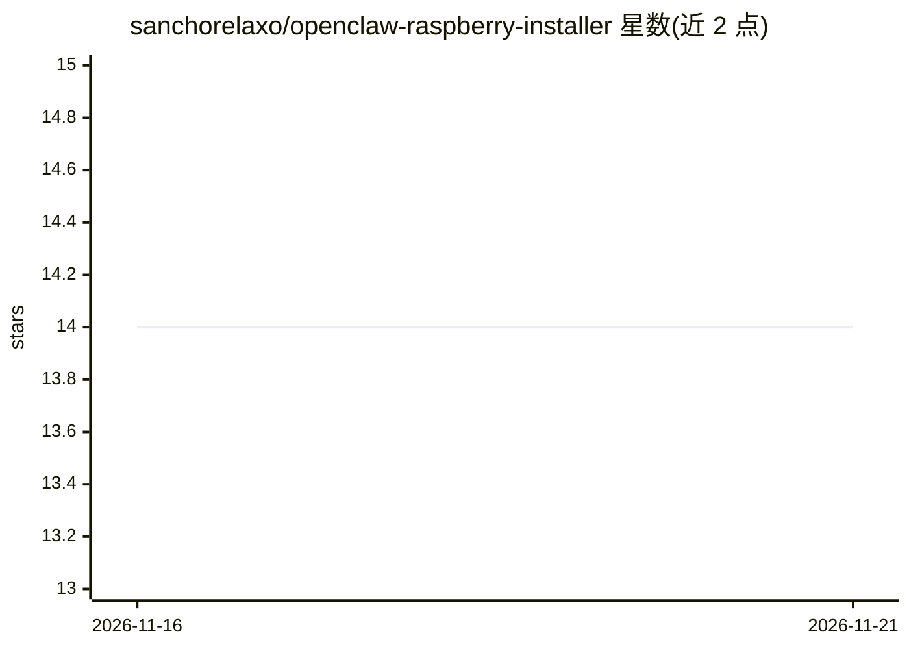

# sanchorelaxo/openclaw-raspberry-installer

⭐ 14 · Shell · 推送 2026-03-11 · [GitHub](https://github.com/sanchorelaxo/openclaw-raspberry-installer) · 个人维护

**树莓派 5 + Hailo-10H 上自动安装本地 AI 助手栈的脚本**

面向 CanaKit 树莓派 5 GenAI 套件（AI HAT+ 2 / Hailo-10H）的一键安装 Shell 脚本：分阶段安装系统依赖（Node、Docker）、Hailo GenAI 栈（hailo-ollama 与可选清洗代理）及七种可选助手分支（OpenClaw/PicoClaw/ZeroClaw/Nanobot/Moltis/IronClaw/NullClaw），OpenClaw 分支含工具、频道配置与 RAG 等附加阶段，并提供统一聊天前端、SSH 回归测试与跨分支计时矩阵。支持在线与离线两种安装路径。

## 筛选速览

| 维度 | 判定 | 备注 |
|---|---|---|
| AI 角色 | `ai-ecosystem` | LLM/agent 周边工具 |
| 许可风险 | `none` | — |
| 部署形态 | `None` |  |
| 模型依赖 | local-ok | 支持本地模型 |
| 硬件要求 | — | 无带数字的原话,不猜 |
| 安装摩擦 | `low` | 无编译、无系统依赖或容器化 |
| 成熟度 | — | 结构信号不足 |

## 能力要点

- 七种可切换助手分支（CLAW_FLAVOR 环境变量）
- 部署 hailo-ollama（127.0.0.1:8000）与可选清洗代理（:8081）本地模型路径
- 统一聊天 facade 前端与 SSH 跨分支验证/计时测试脚本
- 支持在线安装与离线 bundle 两种安装方式

## 适用场景

- 在树莓派 5 + AI HAT+ 2 上快速搭建本地 AI 助手
- 对比不同助手分支在同一 Hailo 硬件上的运行表现
- 离线环境为树莓派预置安装包再部署

## 场景标签

`AI 助手` · 领域:对话与助手

## 证据(README 行号)

> L11: This project installs and configures a local assistant stack on Raspberry Pi:
> L14: 2. Hailo GenAI stack (`hailo-ollama`) and optional sanitizing proxy

## 星数曲线

2026-11-16 14 → 2026-11-21 14（+0）

---
*卡片 v1 · prompt 1.4 · 生成 2026-11-18 · 置信度 high · 依据 README sha `06488e3e2493` · [字段定义](../../DATASET.md)*
