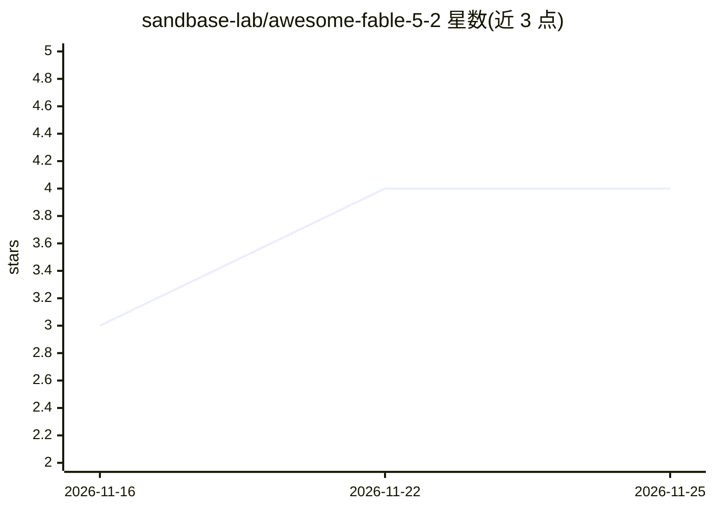

# sandbase-lab/awesome-fable-5-2

⭐ 4 · Python · NOASSERTION · 推送 2026-11-20 · [GitHub](https://github.com/sandbase-lab/awesome-fable-5-2) · [官网](https://www.sandbase.ai/lab/ai-videos/fable-5-2) · 组织维护 · 中文 README

**Claude Fable 5.2 生成作品的视频/提示词策展清单**

收录 400 个由 Claude Fable 5.2 生成的作品视频，来自 280 位创作者，其中 63 个附创作者提示词；按 3D 场景、canvas 动画、动态图形等类别组织，多数作品为模型从单条提示词写出的单个 HTML 页面。附带提示词指南（7 种模式与填空模板）和 prompt→HTML→MP4 教程，并做与 Claude Opus 5.5、GPT-6 Astra、Gemini 4 Argon 的模型对比。每日从 SandBase Lab 同步。

## 筛选速览

| 维度 | 判定 | 备注 |
|---|---|---|
| AI 角色 | `ai-knowledge` | 知识聚合/清单类 |
| 许可风险 | `none` | NOASSERTION |
| 部署形态 | `None` |  |
| 模型依赖 | — | README 未给出锁定关系 |
| 硬件要求 | — | 无带数字的原话,不猜 |
| 安装摩擦 | `low` | 无编译、无系统依赖或容器化 |
| 成熟度 | — | 结构信号不足 |

## 能力要点

- 400 个视频、280 位创作者，63 条附原始提示词，每日同步
- 提示词指南：7 种模式与填空模板
- 教程覆盖 prompt→HTML→MP4，含 API、CLI 与录制脚本
- 含与其他模型的对比章节

## 适用场景

- 浏览他人用 Claude 生成的 3D 场景与动画作品找灵感
- 复制现成提示词复现同类 Three.js/WebGL 场景
- 按教程自制提示词并录制成视频
- 对比不同模型生成此类作品的效果

## 场景标签

`提示工程` `精选清单` `教程课程` · 领域:Agent 开发

## 证据(README 行号)

> L9: A curated list of **Claude Fable 5.2 examples**: videos, prompts and demos made with Anthropic's newest Claude 5 mod
> L11: **400 videos** from **280 creators** · **63** with the creator's prompt · synced daily from SandBase Lab
> L19: |Write your own prompt|Prompt guide: 7 patterns and a fill-in template|

## 星数曲线

2026-11-16 3 → 2026-11-25 4（+1）

---
*卡片 v1 · prompt 1.4 · 生成 2026-11-21 · 置信度 high · 依据 README sha `fd6db98f202c` · [字段定义](../../DATASET.md)*
