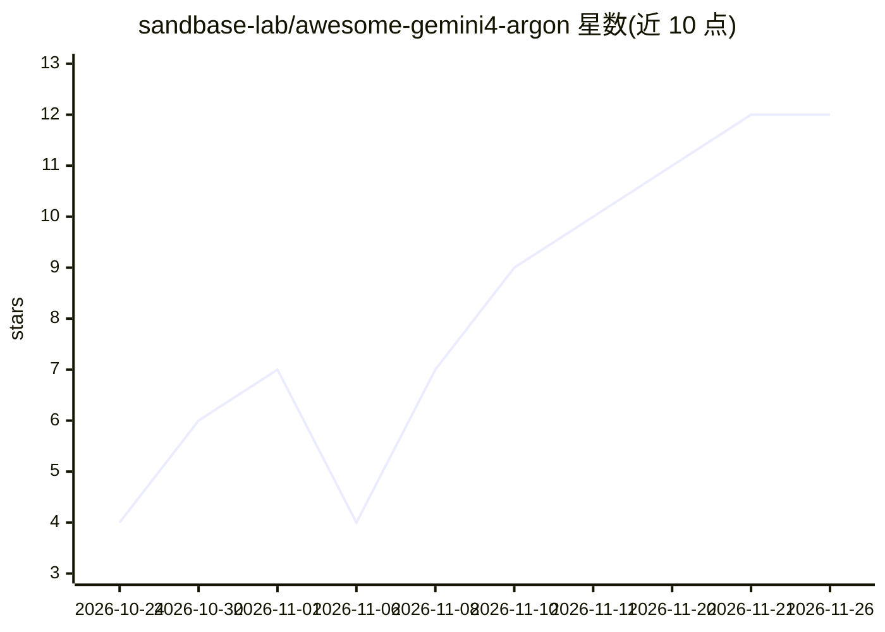

# sandbase-lab/awesome-gemini4-argon

⭐ 12 · Python · NOASSERTION · 推送 2026-11-25 · [GitHub](https://github.com/sandbase-lab/awesome-gemini4-argon) · [官网](https://www.sandbase.ai/lab/ai-videos/gemini-4-argon) · 组织维护 · 中文 README

**Gemini 4 Argon 生成视频与提示词的策展清单**

由 SandBase Lab 维护的 awesome 清单，收录用 Google Gemini 4 Argon 模型生成的示例：400 条视频来自 244 位创作者，其中 81 条附创作者提示词，内容覆盖 Three.js/WebGL 3D 场景、SVG 与 canvas 动画、动态图形和浏览器游戏，逐条署名并链接原帖。清单按类别组织，附带提示词指南（7 种模式与填空模板）、从提示词到 HTML 再到 MP4 的教程，以及与 Claude Opus 5.5、GPT-6 等模型的对比页面，每日从 SandBase Lab 同步。

## 筛选速览

| 维度 | 判定 | 备注 |
|---|---|---|
| AI 角色 | `ai-knowledge` | 知识聚合/清单类 |
| 许可风险 | `none` | NOASSERTION |
| 部署形态 | `None` |  |
| 模型依赖 | — | README 未给出锁定关系 |
| 硬件要求 | — | 无带数字的原话,不猜 |
| 安装摩擦 | `low` | 无编译、无系统依赖或容器化 |
| 成熟度 | — | 结构信号不足 |

## 能力要点

- 收录 400 条视频，来自 244 位创作者，81 条附原始提示词
- 附 7 种模式提示词指南与填空模板
- 提供 prompt→HTML→MP4 的制作教程与录制脚本
- 每日从 SandBase Lab 同步更新

## 适用场景

- 查找 Gemini 4 Argon 生成 Three.js/WebGL 示例的灵感
- 复用创作者公开的提示词制作自己的生成视频
- 按教程从提示词生成 HTML 并录制成 MP4

## 场景标签

`精选清单` `教程课程` · 领域:学习与行业

## 证据(README 行号)

> L9: A curated list of **Gemini 4 Argon examples**: videos, prompts and demos made with Google's Gemini 4 Argon model. Th
> L11: **400 videos** from **244 creators** · **81** with the creator's prompt · synced daily from SandBase Lab
> L19: |Write your own prompt|Prompt guide: 7 patterns and a fill-in template|

## 星数曲线

2026-10-24 4 → 2026-11-26 12（+8）

---
*卡片 v1 · prompt 1.4 · 生成 2026-11-19 · 置信度 high · 依据 README sha `931becc58372` · [字段定义](../../DATASET.md)*
