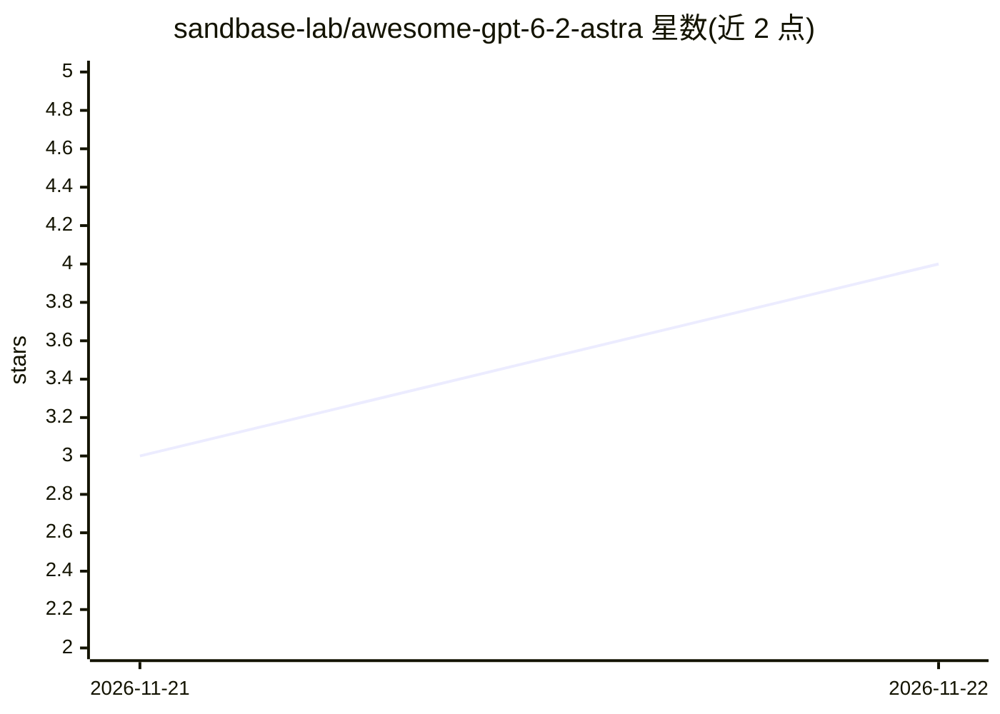

# sandbase-lab/awesome-gpt-6-2-astra

⭐ 4 · Python · NOASSERTION · 推送 2026-11-19 · [GitHub](https://github.com/sandbase-lab/awesome-gpt-6-2-astra) · [官网](https://www.sandbase.ai/lab/ai-videos/gpt-6-2-astra) · 组织维护

**GPT-6.2 Astra 生成视频与提示词的策展清单**

按类别组织的 GPT-6.2 Astra 示例合集：收录 107 条视频、83 位创作者，覆盖 Three.js/WebGPU 三维场景、动态图形、游戏、产品 UI、图表与讲解类内容，每条注明创作者并链接原始帖子；10 条附创作者提示词。另提供提示词指南（2 种模式与填空模板）、从提示词到 HTML 再到 MP4 的教程，以及与 Fable 5.5、Claude Opus 5.5 的对比章节；内容每日从 SandBase Lab 同步。

## 筛选速览

| 维度 | 判定 | 备注 |
|---|---|---|
| AI 角色 | `ai-knowledge` | 知识聚合/清单类 |
| 许可风险 | `none` | NOASSERTION |
| 部署形态 | `None` |  |
| 模型依赖 | — | README 未给出锁定关系 |
| 硬件要求 | — | 无带数字的原话,不猜 |
| 安装摩擦 | `low` | 无编译、无系统依赖或容器化 |
| 成熟度 | — | 结构信号不足 |

## 能力要点

- 107 条视频示例来自 83 位创作者，每日同步
- 10 条示例附创作者提示词，另有提示词指南与教程
- 按 3D 场景、动态图形、游戏、产品 UI 等类别组织
- 含与 Fable 5.5、Claude Opus 5.5 的对比章节

## 适用场景

- 想看 GPT-6.2 Astra 能生成什么样的三维场景与动画视频
- 想复制现成提示词自己生成类似视频
- 想按教程跑通提示词到 HTML 再录制 MP4 的流程
- 想了解该模型与其他模型在同类任务上的对比视频

## 场景标签

`精选清单` `教程课程` `提示工程` · 领域:Agent 开发

## 证据(README 行号)

> L9: A curated list of **GPT-6.2 Astra examples**: videos, prompts and demos made with GPT-6.2 Astra, OpenAI's model anno
> L11: **107 videos** from **83 creators** · **10** with the creator's prompt · synced daily from SandBase Lab
> L20: |Make a video|Tutorial: prompt → HTML → MP4, with the API, the CLI and a recording script|

## 星数曲线

2026-11-21 3 → 2026-11-22 4（+1）

---
*卡片 v1 · prompt 1.4 · 生成 2026-11-21 · 置信度 high · 依据 README sha `3456c445fd18` · [字段定义](../../DATASET.md)*
