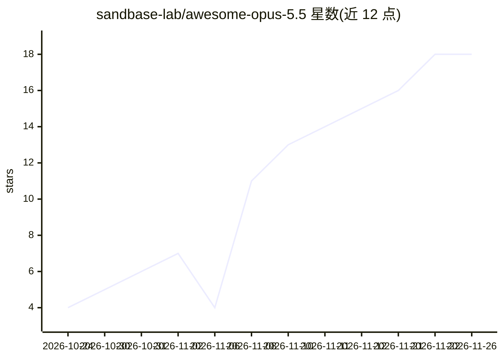

# sandbase-lab/awesome-opus-5.5

⭐ 18 · Python · NOASSERTION · 推送 2026-11-25 · [GitHub](https://github.com/sandbase-lab/awesome-opus-5.5) · [官网](https://www.sandbase.ai/lab/ai-videos/opus-5-5) · 组织维护 · 中文 README

**Claude Opus 5.5 生成作品策展清单：视频、提示词与教程**

由 SandBase Lab 维护并每日同步的 Claude Opus 5.5 作品聚合清单：收录 251 位创作者的 400 个视频（Three.js/WebGL 3D 场景、动效设计、浏览器游戏、Blender 作品等），其中 84 个附创作者原始提示词；按 3D 场景、动效等类别组织，另含 7 种模式的提示词指南、prompt→HTML→MP4 制作教程及与 GPT-6 Astra、Fable 5.1、Gemini 4 Argon、DeepSeek V4.1 Flash 的模型对比。条目署名创作者并链接原帖。

## 筛选速览

| 维度 | 判定 | 备注 |
|---|---|---|
| AI 角色 | `ai-knowledge` | 知识聚合/清单类 |
| 许可风险 | `none` | NOASSERTION |
| 部署形态 | `None` |  |
| 模型依赖 | — | README 未给出锁定关系 |
| 硬件要求 | — | 无带数字的原话,不猜 |
| 安装摩擦 | `low` | 无编译、无系统依赖或容器化 |
| 成熟度 | — | 结构信号不足 |

## 能力要点

- 400 个视频来自 251 位创作者，每日从 SandBase Lab 同步
- 84 个视频附带创作者原始提示词
- 含提示词指南（7 种模式）与 prompt→HTML→MP4 教程
- 提供 Claude Opus 5.5 与多家模型的对比内容

## 适用场景

- 浏览和检索 Claude Opus 5.5 生成的 3D/动效作品
- 复制创作者提示词来复现同类作品
- 学习 prompt 写法并参考模型对比选型

## 场景标签

`精选清单` `提示工程` `教程课程` · 领域:Agent 开发

## 证据(README 行号)

> L9: A curated list of **Claude Opus 5.5 examples**: videos, prompts and demos made with Anthropic's flagship Claude 5 mo
> L11: **400 videos** from **251 creators** · **84** with the creator's prompt · synced daily from SandBase Lab

## 星数曲线

2026-10-24 4 → 2026-11-26 18（+14）

---
*卡片 v1 · prompt 1.4 · 生成 2026-11-18 · 置信度 high · 依据 README sha `60e746f7a405` · [字段定义](../../DATASET.md)*
