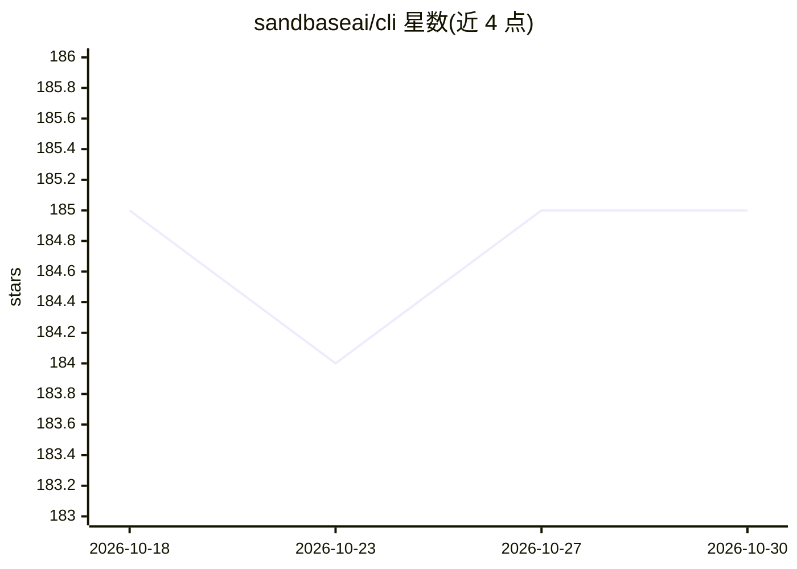

# sandbaseai/cli

⭐ 185 · TypeScript · Apache-2.0 · 推送 2026-10-24 · [GitHub](https://github.com/sandbaseai/cli) · [官网](https://sandbaseai.github.io/cli/) · 组织维护 · 中文 README

**连接 25 个 AI 客户端到 2,000+ 模型/API 的本地 MCP 网关 CLI**

面向 AI 编码工具用户的 CLI 与本地 MCP 桥接服务：一条 connect 命令完成浏览器 OAuth 授权，为 Cursor、Claude Code、Codex、ChatGPT 等 25 个客户端自动配置 MCP，经 HTTPS 访问 SandBase API 的 2,000+ 模型与数据 API（搜索/社交/抓取/电商/金融）。提供 discover/inspect/run/run_get 等 MCP 工具，运行前可查实时价格，数据 API 免费而模型调用计费。无守护进程，凭据本地保存（权限 0600），支持 unregister 回滚与 doctor 检查。

## 筛选速览

| 维度 | 判定 | 备注 |
|---|---|---|
| AI 角色 | `ai-ecosystem` | LLM/agent 周边工具 |
| 许可风险 | `permissive` | Apache-2.0 |
| 部署形态 | `desktop` | 安装包/桌面程序 |
| 模型依赖 | — | README 未给出锁定关系 |
| 硬件要求 | — | 无带数字的原话,不猜 |
| 安装摩擦 | `low` | 无编译、无系统依赖或容器化 |
| 成熟度 | — | 结构信号不足 |

## 能力要点

- 一条命令接入 2,000+ AI 模型与数据 API，无需自行管理各家 API key
- 自动配置 25 个 AI 编码客户端的本地 MCP 桥（OAuth 浏览器授权一次）
- discover→inspect→run 工作流，运行前展示实时价格；数据 API 免费
- doctor 健康检查、unregister 回滚、无守护进程、凭据文件权限 0600

## 适用场景

- 给我的 Cursor/Claude Code/Codex 加上联网搜索、社媒抓取、图像生成等能力
- 在编码助手中统一调用多家 LLM 而不逐个配置 API key
- 运行前先查价格与输入 schema，控制 agent 的调用成本

## 场景标签

`模型网关` · 领域:Agent 开发

## 证据(README 行号)

> L14:  SandBase CLI connects AI clients to 2,000+ AI models and APIs
> L18: **SandBase changes that.** One command connects your agent to 2,000+ AI models and APIs through the Model Context P
> L257: │  (Cursor, etc.) │────────▶│  (on-demand)  │────────▶│ 2,000+ models/APIs │

## 星数曲线

2026-10-18 185 → 2026-10-30 185（+0）

---
*卡片 v1 · prompt 1.4 · 生成 2026-10-23 · 置信度 high · 依据 README sha `aef654b03772` · [字段定义](../../DATASET.md)*
