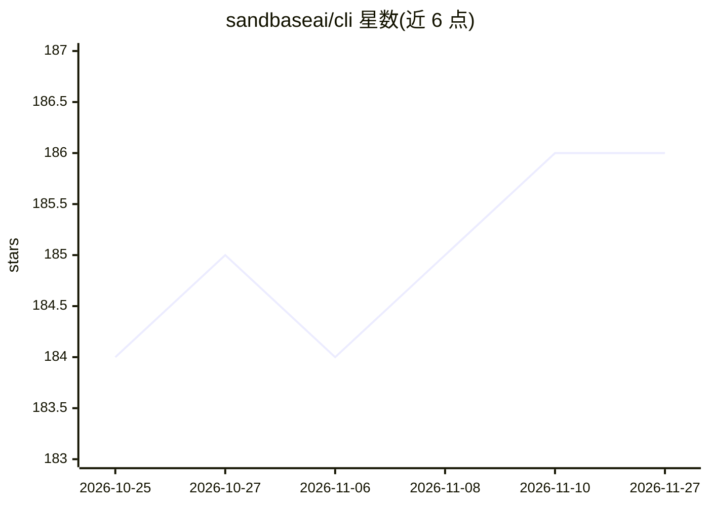

# sandbaseai/cli

⭐ 186 · TypeScript · Apache-2.0 · 推送 2026-11-22 · [GitHub](https://github.com/sandbaseai/cli) · [官网](https://sandbaseai.github.io/cli/) · 组织维护 · 中文 README

**AI CLI 与本地 MCP 桥：把 25 种 AI 客户端接入 2000+ 模型和 API**

SandBase CLI 是一个 Node.js 命令行工具与本地 MCP 桥，通过一次浏览器 OAuth 授权把 Cursor、Claude Code、Codex 等 25 类 AI 客户端连接到 SandBase 的 2000+ 模型与数据 API（搜索、社交媒体、抓取、电商、金融、图像/视频/音频生成）。提供 discover/inspect/run 的工作流，调用前可查看输入 schema 与价格；数据 API 每组织每天 100 次免费额度。无后台守护进程，密钥以 0600 权限存本地。模型调用按量计费。

## 筛选速览

| 维度 | 判定 | 备注 |
|---|---|---|
| AI 角色 | `ai-ecosystem` | LLM/agent 周边工具 |
| 许可风险 | `permissive` | Apache-2.0 |
| 部署形态 | `desktop` | 安装包/桌面程序 |
| 模型依赖 | — | README 未给出锁定关系 |
| 硬件要求 | — | 无带数字的原话,不猜 |
| 安装摩擦 | `low` | 无编译、无系统依赖或容器化 |
| 成熟度 | — | 结构信号不足 |

## 能力要点

- 本地 MCP 桥按需启动，无守护进程与后台进程
- 25 类客户端自动配置（Cursor/Claude Code/Codex/Gemini CLI 等）与 doctor/catalog 只读检查
- discover→inspect→run 流程在计费调用前展示 schema 与实时价格
- 每个 GitHub release 附 SHA-256 校验，可固定版本安装

## 适用场景

- 让 AI 编码代理统一调用模型与数据 API，无需分别管理各平台账号
- 通过自然语言搜索社交数据、生成图片/视频/音频内容
- 在调用前审查价格与参数，控制 API 支出

## 场景标签

`模型网关` · 领域:Agent 开发

## 证据(README 行号)

> L14:  SandBase CLI connects AI clients to 2,000+ AI models and APIs
> L267: │   Your Agent    │  MCP    │  Local Bridge │  HTTPS  │    SandBase API     │

## 星数曲线

2026-10-25 184 → 2026-11-27 186（+2）

---
*卡片 v1 · prompt 1.4 · 生成 2026-11-26 · 置信度 high · 依据 README sha `c88dedc6bf81` · [字段定义](../../DATASET.md)*
