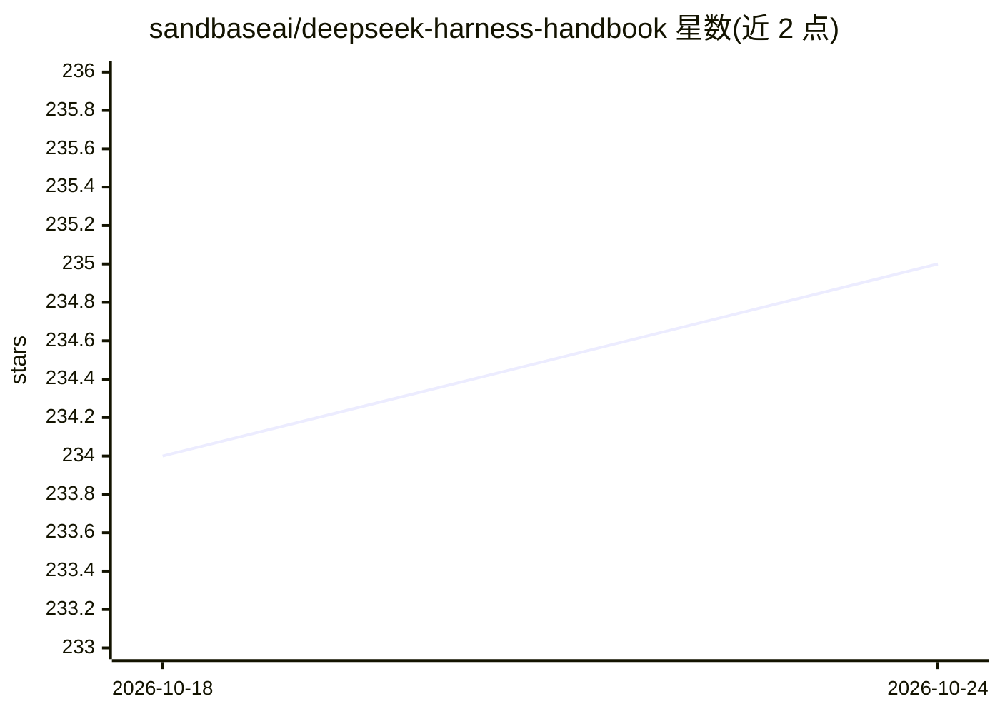

# sandbaseai/deepseek-harness-handbook

⭐ 235 · HTML · Apache-2.0 · 推送 2026-08-31 · [GitHub](https://github.com/sandbaseai/deepseek-harness-handbook) · [官网](https://sandbaseai.github.io/deepseek-harness-handbook/) · 组织维护 · 中文 README

**DeepSeek Harness 的运维手册与资源索引（173 篇指南）**

由 SandBase 维护的社区文档仓库，为 DeepSeek Harness（DSH）这一 Agent 运行时提供源码依据的运维指南：173 篇规范指南、202 份本地化文档、79 条精选 Awesome 资源，覆盖模型路由、工具、沙箱、Sessions、插件、MCP、故障排查与安装诊断（Install Doctor、Failure Router）。版本敏感页面标注所核对的源码修订（rc.2/alpha.1）。仓库本身是文档而非插件，不提供 dsh 安装入口，声明独立于 DeepSeek AI 官方。

## 筛选速览

| 维度 | 判定 | 备注 |
|---|---|---|
| AI 角色 | `ai-knowledge` | 知识聚合/清单类 |
| 许可风险 | `permissive` | Apache-2.0 |
| 部署形态 | `library` | 以包/库形式分发 |
| 模型依赖 | — | README 未给出锁定关系 |
| 硬件要求 | — | 无带数字的原话,不猜 |
| 安装摩擦 | `low` | 无编译、无系统依赖或容器化 |
| 成熟度 | — | 结构信号不足 |

## 能力要点

- 173 篇指南 + 202 份本地化文档 + 79 条源链接资源索引
- 版本敏感页面标注核对的源码修订（rc.2 b150a551 / alpha.1 cd5ef814）
- 按目标组织的任务索引：安装诊断、故障路由、MCP 集成、安全审计
- 多语言基础（英/简中/日/韩/西）与 JSON 资源索引下载

## 适用场景

- 排查 DeepSeek Harness 运行时安装与启动故障
- 查找 DSH 插件、MCP、沙箱、Sessions 的运维方法
- 了解 DSH 生态资源与版本变更的核对证据

## 场景标签

`精选清单` `教程课程` · 领域:学习与行业

## 证据(README 行号)

> L27: **173 canonical guides · 202 localized documents · 79 curated Awesome resources · rc.2 + alpha.1 source-pinned anal
> L79: DeepSeek Harness is more than a model wrapper. It is a composable agent runtime that connects model providers, tool
> L86: > **This repository is documentation, not a DeepSeek Harness plugin.** Do not run `dsh plugin add github:sandbaseai

## 星数曲线

2026-10-18 234 → 2026-10-24 235（+1）

---
*卡片 v1 · prompt 1.4 · 生成 2026-10-22 · 置信度 mid · 依据 README sha `04ec9a439748` · [字段定义](../../DATASET.md)*
