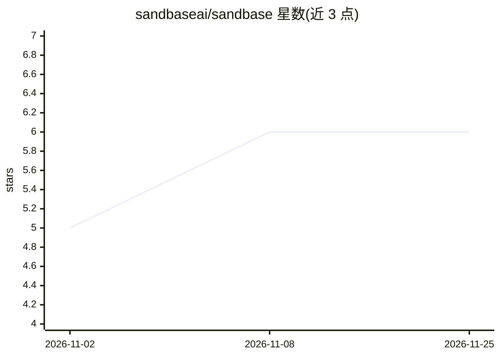

# sandbaseai/sandbase

⭐ 6 · Python · Apache-2.0 · 推送 2026-11-24 · [GitHub](https://github.com/sandbaseai/sandbase) · [官网](https://www.sandbase.ai) · 组织维护 · 中文 README

**一个 API key 接入 2,000+ 模型与数据 API 的 agent 构建平台**

SandBase 提供统一 API key 的模型与数据 API 聚合平台：内置 discover/inspect/run 工具的 agent 在隔离沙箱中自主查找并调用目录内的 500+ AI 模型与 2,200+ 数据 API（社交、搜索、SEO、电商、金融等 150+ 平台）。接口兼容 OpenAI Agents API、Chat Completions 与 Anthropic Messages 格式，沙箱兼容 E2B SDK。提供 Python/TypeScript/Go 无依赖 SDK、CLI/MCP、OpenAPI 3.1 文件与每日刷新的价格目录。沙箱、agent 与每日 100 次数据 API 调用免费，其余按标价计费。

## 筛选速览

| 维度 | 判定 | 备注 |
|---|---|---|
| AI 角色 | `ai-ecosystem` | LLM/agent 周边工具 |
| 许可风险 | `permissive` | Apache-2.0 |
| 部署形态 | `library` | 以包/库形式分发 |
| 模型依赖 | — | README 未给出锁定关系 |
| 硬件要求 | — | 无带数字的原话,不猜 |
| 安装摩擦 | `low` | 无编译、无系统依赖或容器化 |
| 成熟度 | — | 结构信号不足 |

## 能力要点

- 2,000+ 模型与数据 API 统一 `/v1/run` 调用，每日价格目录刷新并留 git 历史记录
- Agent 默认携带 discover/inspect/run 工具，支持会话、HTTP Service 与 Schedule 部署
- 兼容 OpenAI Agents API 与官方 OpenAI SDK，沙箱兼容 E2B SDK（改 E2B_API_URL 即可）
- 提供 llms.txt 与 CLI/MCP 供 AI 编码助手直接接入

## 适用场景

- 用一个 key 在应用里直接调用 LLM、图像/视频模型与各平台数据 API
- 构建能自主寻找并调用工具的个人 agent
- 在 Claude Code、Codex、Cursor 中通过 MCP 调用目录内 API
- 作为 API 提供方通过 pull request 接入平台

## 场景标签

`模型网关` `Agent 框架` · 领域:Agent 开发

## 证据(README 行号)

> L20: Create an agent, give it a job, get the answer. Every agent can find and call any of the 2,000+ models and APIs on 
> L44: Keep the conversation going with `sb.send(reply["session_id"], "...")`. When the agent is ready, deploy it as an HT
> L52: |🤖 **A job**|Sessions, HTTP Services and Schedules on the OpenAgentCore runtime, called through the OpenAI Agents A

## 星数曲线

2026-11-02 5 → 2026-11-25 6（+1）

---
*卡片 v1 · prompt 1.4 · 生成 2026-11-20 · 置信度 high · 依据 README sha `f7ef1a014cf5` · [字段定义](../../DATASET.md)*
