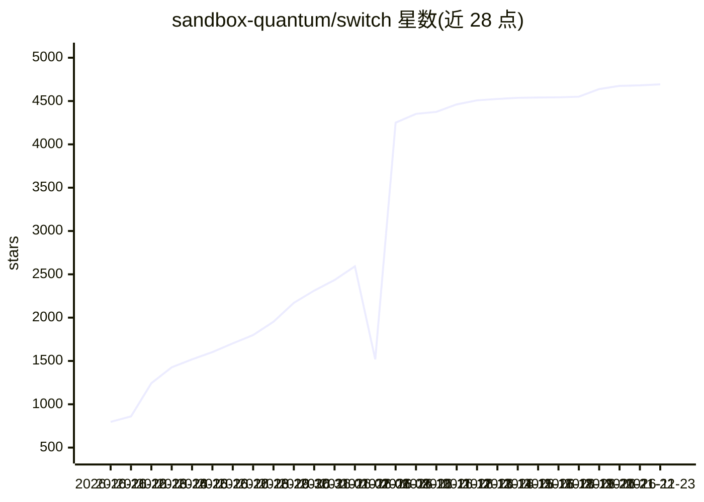

# sandbox-quantum/switch

⭐ 4,693 · Python · NOASSERTION · 推送 2026-11-22 · [GitHub](https://github.com/sandbox-quantum/switch) · [官网](https://www.switchagents.ai) · 组织维护

**让 AI agent 以队友身份在 Slack/Teams 等频道协作的自托管编排平台**

Switch 是一个自托管的多 agent 编排平台：把 Slack、Teams、Discord、Telegram、Mattermost 的每个频道变成人类与 agent 共同工作的房间，共享上下文与文档。它本身不提供 agent 或模型，用户接入已有的 Claude Code、Codex、Cursor、OpenCode 或自建 agent，并为每个 agent 配置角色、指令与连接器（GitHub、Jira、Notion、Google Workspace 等）。提供 macOS/Windows/Linux 桌面端 Switch Console，可自托管或使用即将推出的 Switch Cloud；License 为 Apache 2.0 + Commons Clause，遥测默认开启可关闭。

## 筛选速览

| 维度 | 判定 | 备注 |
|---|---|---|
| AI 角色 | `ai-ecosystem` | LLM/agent 周边工具 |
| 许可风险 | `permissive` | NOASSERTION |
| 部署形态 | `None` |  |
| 模型依赖 | — | README 未给出锁定关系 |
| 硬件要求 | — | 无带数字的原话,不猜 |
| 安装摩擦 | `low` | 无编译、无系统依赖或容器化 |
| 成熟度 | — | 结构信号不足 |

## 能力要点

- 接入已有 agent（Claude Code、Codex、Cursor、OpenCode、LangChain/ADK 自建）到 IM 频道协作
- 为 agent 配置角色、指令与连接器，按房间控制可见性与权限
- 提供 macOS/Windows/Linux 桌面端 Console，支持自托管与托管云
- 文档通过 MCP 服务器提供，可让 agent 引导完成上手

## 适用场景

- 让团队在现有 Slack/Teams 频道里与 AI agent 共同处理 bug 分诊与修复
- 用 manager agent 自动创建频道、拉入合适的人与 agent 并附上上下文
- 通过 chatops 在告警频道内由 agent 收集日志、回滚部署或写复盘

## 场景标签

`Agent 框架` `多智能体` · 领域:Agent 开发

## 证据(README 行号)

> L3: **Open-source AI teammates, working alongside your team in Slack, Teams, Discord, Telegram and Mattermost. Self-host
> L23: - 🌍 **Any agent, any model, any provider**. Your Claude Code agent on your laptop, a teammate's Codex agent on thei
> L101: - ❌ **Not an agent provider**. Switch ships no agents and no models. You keep Claude Code, Codex, Antigravity, Cur

## 星数曲线

2026-10-21 797 → 2026-11-23 4,693（+3,896）

---
*卡片 v1 · prompt 1.4 · 生成 2026-11-22 · 置信度 high · 依据 README sha `32fc17e50c94` · [字段定义](../../DATASET.md)*
