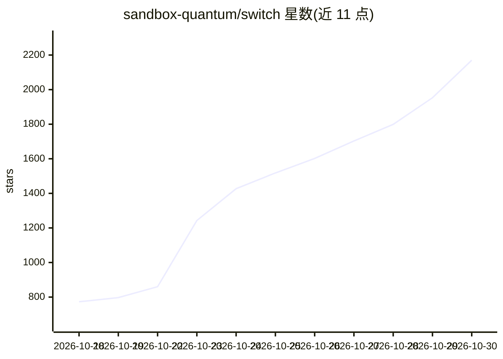

# sandbox-quantum/switch

⭐ 2,170 · Python · NOASSERTION · 推送 2026-10-29 · [GitHub](https://github.com/sandbox-quantum/switch) · [官网](https://www.switchagents.ai) · 组织维护

**把 AI agent 以队友形式接入团队聊天平台的自托管网关**

将 Slack、Teams、Discord、Telegram、Mattermost 频道转为人类与 AI agent 共享上下文的协作房间；agent 本身与模型由用户自带（Claude Code、Codex、LangChain 等，凡支持协议即可接入），Switch 不提供 agent 与模型，负责接入、房间权限与上下文管理。自托管部署，团队上下文留在本方服务器。提供桌面端 Switch Console（macOS/Windows/Linux 安装包）与 MCP 文档服务；许可为 Apache 2.0 + Commons Clause，Console 遥测默认开启可关闭。

## 筛选速览

| 维度 | 判定 | 备注 |
|---|---|---|
| AI 角色 | `ai-ecosystem` | LLM/agent 周边工具 |
| 许可风险 | `permissive` | NOASSERTION |
| 部署形态 | `None` |  |
| 模型依赖 | — | README 未给出锁定关系 |
| 硬件要求 | — | 无带数字的原话,不猜 |
| 安装摩擦 | `low` | 无编译、无系统依赖或容器化 |
| 成熟度 | — | 结构信号不足 |

## 能力要点

- 支持 Slack/Teams/Discord/Telegram/Mattermost 五个聊天平台
- 自带 agent 与模型（Claude Code/Codex/LangChain 等按协议接入）
- 自托管，上下文数据留在本地服务器
- 文档以 MCP 服务器形式提供，可由 agent 引导阅读

## 适用场景

- 让 Claude Code/Codex 等 agent 在团队频道中与人协作
- 配置 agent 分诊、编码、部署等分级工作流
- 自托管管理团队与 AI 的共享上下文和权限

## 场景标签

`多智能体` · 领域:Agent 开发

## 证据(README 行号)

> L3: **Open-source AI teammates, working alongside your team in Slack, Teams, Discord, Telegram and Mattermost. Self-host
> L23: - 🌍 **Any agent, any model, any provider**. Your Claude Code agent on your laptop, a teammate's Codex agent on thei
> L93: - ❌ **Not an agent provider**. Switch ships no agents and no models. You keep Claude Code, Codex, OpenCode or whate

## 星数曲线

2026-10-18 773 → 2026-10-30 2,170（+1,397）

---
*卡片 v1 · prompt 1.4 · 生成 2026-10-21 · 置信度 high · 依据 README sha `c3a910adf4ac` · [字段定义](../../DATASET.md)*
