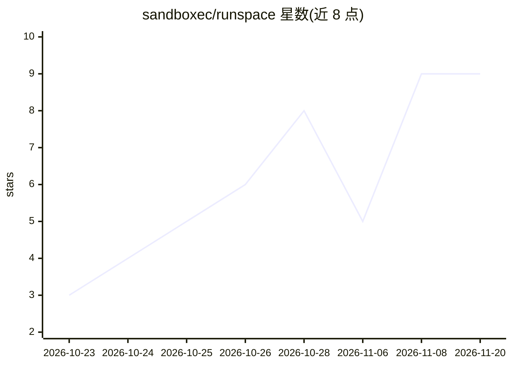

# sandboxec/runspace

⭐ 9 · Go · MIT · 推送 2026-10-22 · [GitHub](https://github.com/sandboxec/runspace) · [官网](https://runspace.sandbox.ec) · 组织维护

**为人和 AI agent 提供基于 GitHub Codespaces 的一次性云端沙箱**

runspace 在一次性 GitHub Codespaces 中执行命令，使依赖安装、构建与测试运行在沙箱 VM 而非宿主机上。它是一个静态二进制，提供 CLI 与 MCP server 两种前端；agent 可创建沙箱、在其中运行命令、复制文件进出，并以 patch 形式取回成果。只需 GitHub token 即可工作，无守护进程与本地状态。限制：依赖未公开的 codespace 连接协议，可能随时变更；沙箱计算由对应账号的 Codespaces 计费承担。

## 筛选速览

| 维度 | 判定 | 备注 |
|---|---|---|
| AI 角色 | `ai-ecosystem` | LLM/agent 周边工具 |
| 许可风险 | `permissive` | MIT |
| 部署形态 | `desktop` | 安装包/桌面程序 |
| 模型依赖 | — | README 未给出锁定关系 |
| 硬件要求 | — | 无带数字的原话,不猜 |
| 安装摩擦 | `low` | 无编译、无系统依赖或容器化 |
| 成熟度 | — | 结构信号不足 |

## 能力要点

- 单静态二进制，提供 CLI 与 MCP server（stdio）两种前端
- create/exec/diff/cp/delete 命令覆盖沙箱全生命周期，成果以 patch 取回
- 只需 GitHub token，无守护进程与本地状态
- 提供 SKILL.md agent skill 教会 agent 使用其工作流

## 适用场景

- 让 AI agent 在隔离沙箱中执行构建与测试，避免污染宿主机
- 在远程环境中运行不可信代码并取回 patch
- 为 agent harness 配置受限工具集，只暴露沙箱操作

## 场景标签

 · 领域:开发者工具/agent 沙箱基础设施

## 证据(README 行号)

> L7:  Disposable cloud sandboxes for humans and AI agents, powered by GitHub Codespaces.
> L16: - a MCP server for AI agents
> L218: ## Use runspace with an AI agent
> L233: runspace runs the agent's commands in sandboxes, as long as the harness

## 星数曲线

2026-10-23 3 → 2026-11-20 9（+6）

---
*卡片 v1 · prompt 1.4 · 生成 2026-11-20 · 置信度 high · 依据 README sha `befc078c304f` · [字段定义](../../DATASET.md)*
