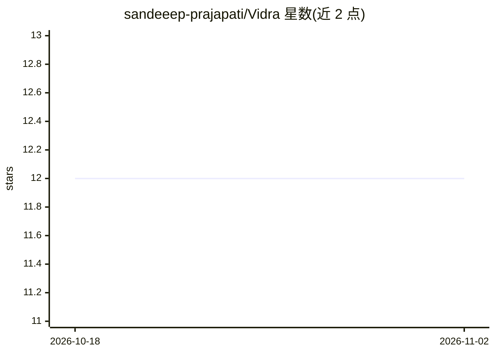

# sandeeep-prajapati/Vidra

⭐ 12 · Blade · 推送 2026-05-11 · [GitHub](https://github.com/sandeeep-prajapati/Vidra) · 个人维护

**Laravel 学校管理系统：学生/考试/收费等全模块，AI 为付费定制**

基于 Laravel 13 与 PHP >=8.3 的学校 ERP，免费功能覆盖学生、教职工、班级、课程、考勤、考试与成绩单、费用财务、课表、多渠道通知（SMS/Email/App）、RBAC（Spatie Permissions）、宿舍与校车管理，多数模块支持 CSV 导入导出。另列 16 项付费定制模块，包括图书馆、校友、在线招生、GPS 校车跟踪，以及 AI 功能（预测洞察、智能推荐）与 OCR 数据导入。提供 Web 安装向导、artisan CLI 安装命令与手动安装三种途径。

## 筛选速览

| 维度 | 判定 | 备注 |
|---|---|---|
| AI 角色 | `ai-enhanced` | 去掉 AI 部分产品仍成立 |
| 许可风险 | `none` | — |
| 部署形态 | `library` | 以包/库形式分发 |
| 模型依赖 | — | README 未给出锁定关系 |
| 硬件要求 | — | 无带数字的原话,不猜 |
| 安装摩擦 | `low` | 无编译、无系统依赖或容器化 |
| 成熟度 | — | 结构信号不足 |

## 能力要点

- 11 类免费模块覆盖学校运营全流程，含 RBAC 与多渠道通知
- Web 向导 / php artisan school:install CLI / 手动三种安装方式
- 16 项付费定制模块含 AI 洞察、OCR 数据导入、GPS 校车跟踪

## 适用场景

- 学校统一管理学生、教职工、考试与收费流程
- 需要课表生成与多渠道家校通知
- 通过 Web 向导快速部署自托管校务系统

## 场景标签

 · 领域:教育/管理系统

## 证据(README 行号)

> L3: A comprehensive school management system built with **Laravel 13**, covering students, staff, classes, subjects, exa
> L213: ### 15. AI Features

## 星数曲线

2026-10-18 12 → 2026-11-02 12（+0）

---
*卡片 v1 · prompt 1.4 · 生成 2026-11-01 · 置信度 low · 依据 README sha `bf8f955a4f5c` · [字段定义](../../DATASET.md)*
