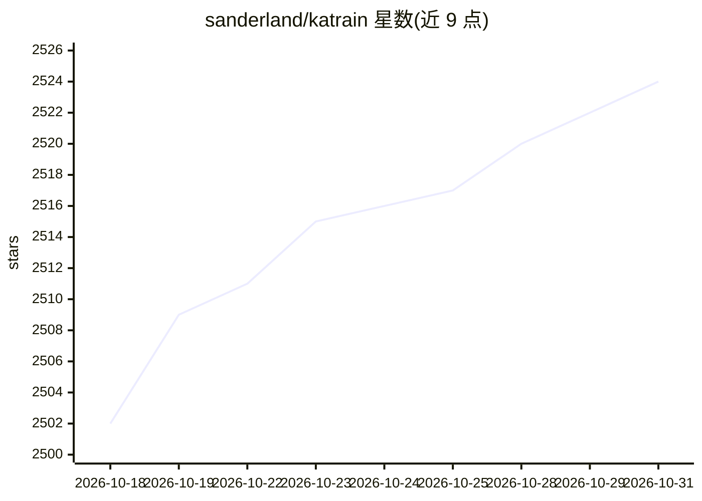

# sanderland/katrain

⭐ 2,524 · Python · NOASSERTION · 推送 2026-10-26 · [GitHub](https://github.com/sanderland/katrain) · 个人维护

**围棋训练桌面应用：用 KataGo 分析对局并陪练**

基于 Kivy 的围棋（Baduk）学习与对弈工具，内置 KataGo 分析引擎与 b10c384h6nbt transformer 模型，Windows/Linux/macOS 开箱即用。功能包括复盘对局按目数损失标注失误、教学对局自动悔棋、多种校准段位与风格化 AI 对手（Human-like、Historical Pro、KataJigo 等）、变着探索与深入分析、死活题求解、生成聚焦失误的 SGF 复盘。可切换模型与 KataGo 二进制（CUDA/TensorRT/ROCm/ONNX），也可覆盖引擎启动命令连接远程服务器。提供 Windows/macOS 安装包，并支持 pipx/PyPI 与 brew 安装。

## 筛选速览

| 维度 | 判定 | 备注 |
|---|---|---|
| AI 角色 | `ai-native` | 本体是模型或模型工具 |
| 许可风险 | `permissive` | NOASSERTION |
| 部署形态 | `desktop` | 安装包/桌面程序 |
| 模型依赖 | — | README 未给出锁定关系 |
| 硬件要求 | — | 无带数字的原话,不猜 |
| 安装摩擦 | `medium` | 含编译或系统依赖之一 |
| 成熟度 | — | 结构信号不足 |

## 能力要点

- 复盘按目数损失标注每手失误并生成 SGF 复盘
- 多种校准段位与风格的 AI 对手（含 KataGo 全强度、Human-like 人类模型）
- 内置 KataGo（OpenCL/Metal 后端）与 transformer 模型，可下载切换不同后端二进制
- 分析模式支持深度分析、期望领地、死活题框定与连续分析

## 适用场景

- 复盘自己的棋局，找出目数损失最大的失误
- 与不同段位、不同风格的 AI 对弈并即时获得反馈
- 做死活题和定式局部分析
- 给初学者上课用的教学对局（坏棋自动悔棋重下）

## 场景标签

 · 领域:游戏/棋类训练工具

## 证据(README 行号)

> L9: KaTrain is a tool for analyzing games and playing go with AI feedback from KataGo:
> L49: KaTrain comes pre-packaged with a working KataGo for Windows, Linux and Mac (OpenCL, except on Apple Silicon where 

## 星数曲线

2026-10-18 2,502 → 2026-10-31 2,524（+22）

---
*卡片 v1 · prompt 1.4 · 生成 2026-10-21 · 置信度 high · 依据 README sha `ae6fc51d9bfb` · [字段定义](../../DATASET.md)*
