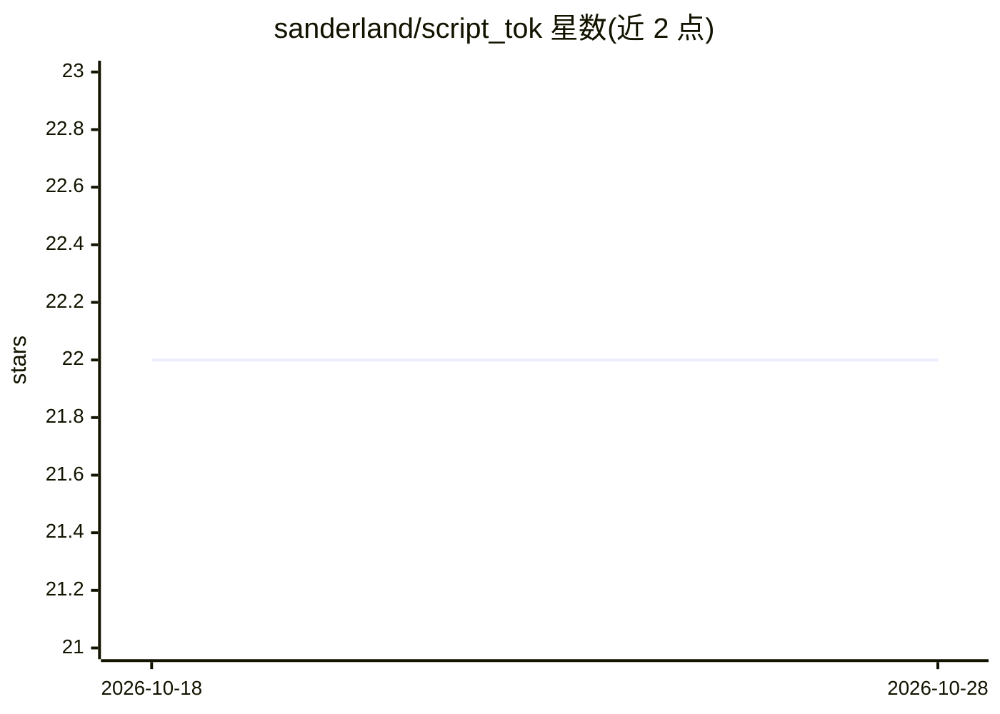

# sanderland/script_tok

⭐ 22 · Python · Apache-2.0 · 推送 2026-10-21 · [GitHub](https://github.com/sanderland/script_tok) · 个人维护

**面向研究者的子词分词算法实现库（BPE/Unigram/MinGram 等）**

提供 SCRIPT 编码预分词及多种分词算法的 Python 实现：预分词模块（UTF-8、SCRIPT 编码、混合方案）、BPE（多 worker 训练）、Unigram（EM 训练与 Viterbi 解码）、MinGram、PathPiece、ConvexTok 基线，以及压缩率与形态学对齐评测工具。含 paper_utils 目录复现四篇论文结果，通过 uv 运行训练与实验脚本。面向分词研究与论文复现场景。

## 筛选速览

| 维度 | 判定 | 备注 |
|---|---|---|
| AI 角色 | `ai-ecosystem` | LLM/agent 周边工具 |
| 许可风险 | `permissive` | Apache-2.0 |
| 部署形态 | `None` |  |
| 模型依赖 | — | README 未给出锁定关系 |
| 硬件要求 | — | 无带数字的原话,不猜 |
| 安装摩擦 | `low` | 无编译、无系统依赖或容器化 |
| 成熟度 | — | 结构信号不足 |

## 能力要点

- 实现 BPE/Unigram/MinGram/PathPiece/ConvexTok 五种分词算法
- SCRIPT 编码系列预分词器（含字符边界与继承脚本约束变体）
- 压缩率与形态学对齐（MorphAlign）评测工具
- paper_utils 脚本复现四篇论文的表格与图表

## 适用场景

- 训练与比较不同子词分词算法
- 复现 BPE Stays on SCRIPT 等论文结果
- 评测分词器的压缩率与形态学对齐

## 场景标签

`模型评测` · 领域:评测与运维

## 证据(README 行号)

> L4: It contains implementations for **BPE**, **Unigram**, **MinGram**, **PathPiece**, and **ConvexTok** tokenization alg
> L14: This repository provides tools for SCRIPT encoding-based pre-tokenization with BPE and Unigram, as well as regular 
> L72: The `paper_utils/` directory contains scripts to reproduce paper results from scratch:

## 星数曲线

2026-10-18 22 → 2026-10-28 22（+0）

---
*卡片 v1 · prompt 1.4 · 生成 2026-10-27 · 置信度 high · 依据 README sha `e9dfc3d3b286` · [字段定义](../../DATASET.md)*
