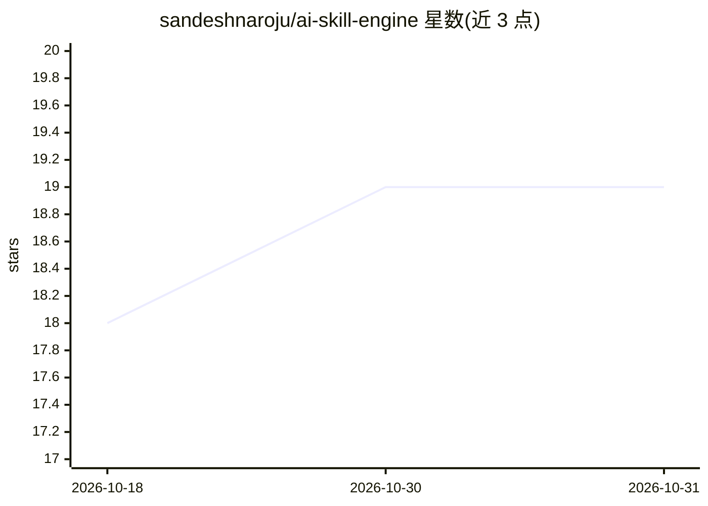

# sandeshnaroju/ai-skill-engine

⭐ 19 · JavaScript · NOASSERTION · 推送 2026-09-27 · [GitHub](https://github.com/sandeshnaroju/ai-skill-engine) · 个人维护

**自托管多租户 AI 网关：OpenAI 兼容 API+沙箱执行+技能中心**

企业自托管 AI 网关与 agent 执行框架：对外暴露单一 OpenAI 兼容 /api/v1/chat/completions 端点，内部提供 Docker/Azure Container Apps/E2B 隔离沙箱执行 Python 代码、多租户 API key 与成本审计、SKILL.md 热加载技能、MCP 工具接入、Azure Blob/S3/本地文件存储及 Canvas 工件（文档/表格/幻灯片/3D CAD）。支持 OpenAI、Gemini、OpenRouter 或自定义 LLM，通过 Docker Hub 预编译容器部署，端口 2704。云端托管版尚在开发中。

## 筛选速览

| 维度 | 判定 | 备注 |
|---|---|---|
| AI 角色 | `ai-ecosystem` | LLM/agent 周边工具 |
| 许可风险 | `none` | NOASSERTION |
| 部署形态 | `self-host` | docker 或自建部署 |
| 模型依赖 | — | README 未给出锁定关系 |
| 硬件要求 | — | 无带数字的原话,不猜 |
| 安装摩擦 | `low` | 无编译、无系统依赖或容器化 |
| 成熟度 | — | 结构信号不足 |

## 能力要点

- OpenAI 线协议兼容的单端点网关，SSE 流式返回状态/推理/工具调用增量
- Docker/Azure/E2B 多种隔离沙箱执行代码
- 多租户隔离工作区与按租户 token 成本核算、审计日志
- SKILL.md 工具定义支持控制台热编辑与 AI 生成

## 适用场景

- 让聊天机器人或业务后端统一接入多种 LLM 与工具调用能力
- 为不同客户提供隔离的 API key、技能集与成本核算
- 在对话中生成并协同编辑文档、表格、幻灯片与 3D CAD 工件

## 场景标签

`模型网关` `Agent 框架` · 领域:Agent 开发

## 证据(README 行号)

> L3:  Enterprise self-hosted AI gateway, agent execution harness, and multi-tenant skill hub.
> L55: An all-in-one AI gateway and tool-calling execution harness. Point your chatbot or business backend at this server'
> L81: The gateway is 100% compatible with the standard OpenAI wire protocol:

## 星数曲线

2026-10-18 18 → 2026-10-31 19（+1）

---
*卡片 v1 · prompt 1.4 · 生成 2026-10-29 · 置信度 high · 依据 README sha `c619a437170c` · [字段定义](../../DATASET.md)*
